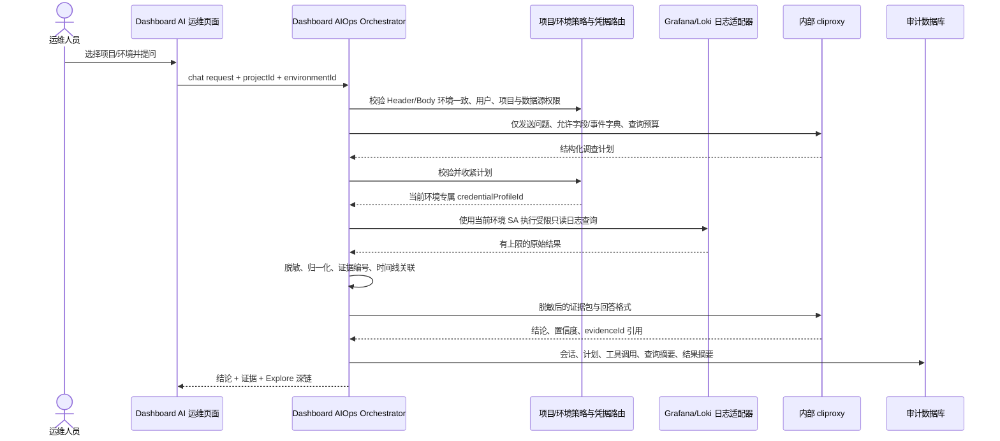

# AI 运维：按项目/环境隔离的日志调查与业务流转分析开发计划

## 1. 结论与范围

### 1.1 结论

**可行，建议作为 AI 运维的第一个只读调查型 Agent 场景立项。**

目标不是实现一个能任意操作 Grafana 的聊天机器人，而是在 Dashboard 的项目/环境边界内，提供一个可审计的通用日志调查入口：运维人员选择项目和环境后，可以直接描述故障现象、服务异常、关键字、时间段或业务问题，也可以附带仓位 ID、UID、订单号、trace ID 等关联标识；系统从该项目批准的日志数据源获取有限、脱敏的证据，由模型归纳异常原因、相关日志、时间线、业务流转、缺失环节与下一步排查建议。

首期只读，不执行 Grafana 配置修改、查询以外的 API 操作、Kubernetes 操作、数据库写入或自动处置。

**凭据边界必须按环境隔离。** 每个环境使用该环境自己的 Grafana Service Account Token；禁止使用一个全局 SA Token 跨环境读取日志，也禁止在某环境缺少配置时回退到其他环境或全局 Token。项目负责约束 datasource、namespace、service 和字段范围，环境负责确定 Grafana 实例、组织和认证身份，两层约束必须同时满足。

### 1.2 与当前 Dashboard 的衔接

当前代码已经具备下列可复用基础：

- `AiOpsModule`、`/ai-ops` 菜单与 `menu:ai-ops` 权限；
- 全局环境选择，并将 `X-Target-Environment` 作为后端环境边界；
- OpenAI-compatible cliproxy LLM 网关适配；旧的 `openclaw` 配置键仅作为迁移期兼容回退；
- `aiops_sessions`、`aiops_actions`、`aiops_ingest_events` 与 SQL 专项审计；
- 后端代理调用受控下游的模式：查询中心 Agent / Kubernetes Service Proxy；
- 资产、CI/CD、监控申请等模块已有环境、权限、审计和受控下游的实现经验。

当前 AI 运维页面实际上只提供 SQL 草稿预览与 SQL 审计；没有通用对话接口、Grafana/Loki 数据源目录、日志检索器或跨日志证据关联能力。本计划应新增这些能力，不改变现有 SQL 安全契约。

### 1.3 首期用户路径

1. 用户进入“AI 运维”，选择有权限的项目与环境。
2. 输入自然语言问题，例如“为什么支付服务从 10:20 开始大量超时”“查找某服务最近一小时的数据库连接异常”，或者“查询仓位 `P123` 与 UID `U456` 的业务流转”。
3. Dashboard 识别候选服务、namespace、关键字、日志级别、时间范围与可选业务标识，必要时让用户确认歧义。业务标识不是必填条件。
4. 模型只生成结构化的 `LogInvestigationPlan`，不生成任意 HTTP 请求或任意 LogQL。
5. 后端按项目绑定的数据源、字段字典和选择器策略校验计划，执行最多若干个有上限的只读查询。
6. 后端先脱敏、截断、去重、排序并保存证据摘要；模型仅基于这些证据输出结论。
7. 页面显示结论、置信度、时间线、未证实推断、证据引用、实际执行的查询摘要和 Grafana Explore 深链；所有步骤写入审计。

## 2. 架构原则

1. **项目与环境先于对话。** 项目是数据源、允许的标签、业务字段字典和访问策略的容器；不得依赖模型从用户文本猜测项目。
2. **模型不持有凭证，不直连 Grafana。** 浏览器也不接触 Grafana service-account token。Token 仅由 Dashboard 后端的受控密钥引用解析。
3. **凭据按环境选择且失败关闭。** 后端只能用已校验的 `environmentId` 解析该环境的 Grafana 凭据；未配置、已禁用或连通性异常时阻断查询，不得使用全局默认值或其他环境凭据兜底。
4. **模型提出计划，代码执行计划。** LLM 输出必须满足 JSON Schema；后端对数据源、标签、时间范围、查询数、结果量和风险字段做确定性验证。
5. **日志是不可信输入。** 日志中的文本可包含提示注入、凭证、个人信息或伪造指令；其只能作为证据，不可覆盖系统指令、改变工具权限或触发动作。
6. **答案必须可追溯。** 每个关键结论关联到 `evidenceId`、时间、来源项目/环境/数据源、日志数量和查询摘要。没有证据的内容标注“推测”或“不足以判断”。
7. **跨项目、跨环境默认隔离。** 单次会话固定一个项目、一个环境；首期不开放跨项目或跨环境查询。后续即使开放，也须单独权限、显式多选、逐环境独立取证和审计，不得把凭据或原始结果混用。
8. **以结构化事件优先于全文日志。** 可解析的 `eventType`、`traceId`、`positionId`、`uid`、`orderId`、`status`、`service` 等字段应作为关联依据；自由文本仅作补充。
9. **问题入口通用，执行仍然有界。** 不按 UID、仓位或订单类型限制用户能问什么，也不为每类业务标识单独设置权限；但模型计划仍须至少包含受控服务/namespace、有限时间范围、受控关键字或结构化过滤条件之一，禁止无条件扫描整个日志平台。

## 3. 推荐架构



### 3.1 不建议的实现方式

- 不让前端直接请求多个 Grafana 实例；会泄露 Token，且绕开 Dashboard 权限、速率控制和审计。
- 不配置全局 Grafana Token，也不允许环境 A 使用环境 B 的 SA Token；这会把一次路由或配置错误放大为跨环境数据泄漏。
- 不将用户问题直接拼接成 LogQL/PromQL 后执行；需先转为受限的领域查询计划。
- 不把完整原始日志、任意时长的历史数据或密钥字段投递给模型。
- 不从 Lark 群消息反向抽取调查事实；Lark 是通知出口，不是事实源。
- 不在首期引入泛化的多 Agent 自主循环。规则路由 + 有界的“计划 → 工具 → 证据 → 总结”足以解决此场景，也更容易测评与审计。

### 3.2 Grafana 接入选择

优先确认每个项目的真实日志后端，再实施对应适配器：

| 后端 | 首选适配器 | 首期支持方式 |
| --- | --- | --- |
| Grafana + Loki | `LokiLogProvider`，由 Dashboard 后端经 Grafana 数据源查询或 Loki 只读 API 调用 | 受控 LogQL 模板、时间范围、标签白名单 |
| Grafana + Elasticsearch/OpenSearch | `ElasticLogProvider` | 结构化 DSL 模板，不接受任意脚本/聚合 |
| CloudWatch Logs | `CloudWatchLogProvider` | 受控 Logs Insights 模板、查询超时和扫描量预算 |
| 仅有业务日志 Socket | 仅作为既有页面日志查看能力；不作为跨历史调查的首期数据源 | 后续再评估归档与索引能力 |

Grafana 官方 API 支持数据源查询及按 datasource UID 的代理调用；这证明“后端持有受限身份、按数据源执行只读查询”的路径可行，但 Dashboard 仍应自行维护项目到数据源 UID 的映射，不能接受来自客户端或模型的任意 URL/UID。参考：[Grafana Data source API](https://grafana.com/docs/grafana/latest/developer-resources/api-reference/http-api/api-legacy/data_source/)。

### 3.3 凭据路由与存储

将“环境身份”和“项目日志源”拆开，避免把同一 Token 复制到多个项目配置，也避免误把项目级 datasource 规则当成认证边界：

```text
GrafanaCredentialProfile
  credentialProfileId, environmentId, enabled
  grafanaBaseUrlRef, organizationId, serviceAccountName
  tokenSecretRef, timeoutMs, tlsPolicy, rotatedAt

ProjectLogSource
  projectId, environmentId, sourceId, provider, enabled
  credentialProfileId, datasourceUid
  allowedNamespaces, allowedServices, allowedLabels
  ...
```

约束如下：

- `environmentId` 来自服务端认可的全局环境上下文；请求 Body 中若同时携带环境，必须与 `X-Target-Environment` 完全一致。
- `ProjectLogSource.environmentId` 必须与所引用 `GrafanaCredentialProfile.environmentId` 一致；数据库增加组合唯一约束/外键或在注册表加载时做等价的强校验。
- `grafanaBaseUrl` 和 `datasourceUid` 只从服务端目录读取；禁止客户端或模型提供目标 URL，避免 SSRF 和 Token 被转发到错误主机。
- Token 只以 `tokenSecretRef` 引用。生产实现优先使用进程环境变量、受控 Secret 文件或外部 Secret Manager；当前 `dashboard_site_conf` 的敏感标记主要用于界面脱敏，并不等同于静态加密，因此不建议直接保存 Grafana Token 明文。
- `serviceAccountName` 仅用于运维核对和审计，不参与鉴权；实际请求只使用对应环境的 Token。
- cliproxy 是模型网关，可使用独立的全局服务身份，但它不能接收 Grafana Token，也不能决定 Grafana URL、环境凭据或 datasource UID。
- 凭据缺失、环境不匹配、Token 失效、组织不匹配或数据源不在白名单时统一失败关闭，并返回明确的环境配置错误。

## 4. 领域模型与接口契约

### 4.1 项目日志接入目录

新增受控目录（可先配置化，稳定后再建表）：

```text
ProjectLogSource
  projectId, environmentId, sourceId, provider, enabled
  credentialProfileId, datasourceUid
  allowedNamespaces, allowedServices, allowedLabels
  maxRangeHours, maxLinesPerQuery, maxQueriesPerTurn, timeoutMs
  redactionProfileId, eventSchemaVersion
```

其中环境凭据由 `GrafanaCredentialProfile` 统一解析，项目目录只引用同环境的 `credentialProfileId`。URL、UID、密钥引用均由管理员配置；普通用户和模型仅能引用 Dashboard 返回的逻辑 `sourceId`。密钥不能进入会话、审计 JSON、响应或 LLM 上下文。

### 4.2 日志字段与业务事件字典

每个项目维护版本化字典，而不是将字段语义硬编码在 prompt。字典同时覆盖通用日志字段和已知业务事件；缺少业务事件定义时仍允许进行通用错误检索、服务排障和关键字调查，只是不生成未经验证的业务状态流转结论：

```text
LogEventSchema
  projectId, version, eventType
  requiredFields: eventTime, service, message
  commonFields: level, errorCode, exception, latency, httpStatus, endpoint
  correlationFields: positionId, uid, orderId, traceId, requestId
  transition: fromState, toState
  allowedQueryFields, sensitivity, retentionDays
```

通用字段优先支持：服务、namespace、日志级别、错误码、异常类型、HTTP 状态、接口路径、延迟、trace/request ID 和受控关键字。业务事件可以逐步补充，例如 `position.created`、`order.filled`、`risk.rejected`、`api.failed`；无法由日志稳定解析的事件不进入自动流转结论，仅在原文证据中展示。

### 4.3 LLM 的结构化计划

LLM 只能返回如下概念模型：

```ts
type LogInvestigationPlan = {
  intent: 'log_search' | 'service_error' | 'error_explanation' | 'flow_trace' | 'entity_lookup' | 'change_correlation';
  entityFilters?: Array<{ field: 'positionId' | 'uid' | 'orderId' | 'traceId' | 'requestId'; value: string }>;
  keywords?: string[];
  levels?: Array<'debug' | 'info' | 'warn' | 'error' | 'fatal'>;
  timeRange: { from: string; to: string };
  queries: Array<{
    sourceId: string;
    eventTypes?: string[];
    serviceNames?: string[];
    namespaces?: string[];
    correlationFields?: string[];
    purpose: string;
  }>;
  clarification?: string;
};
```

后端负责把它编译为 provider 专属查询。业务标识可以为空，但每个查询必须具备服务/namespace、受控关键字、日志级别或结构化字段过滤等至少一种有效收敛条件。验证器拒绝未知 `sourceId`、未知字段、时间范围超限、真正的空过滤、正则/管道注入、过多查询和不属于当前项目的服务。`LogInvestigationPlan` 不包含 Grafana URL、datasource UID 或 credential profile；这些只能在后端以当前会话固定的 `projectId + environmentId + sourceId` 解析。

### 4.4 建议 API

- `GET /api/ai-ops/projects`：只返回当前用户可进入的项目与环境。
- `POST /api/ai-ops/log-investigations`：创建会话并执行一次有界调查；`X-Target-Environment` 为环境事实来源，Body 中的 `environmentId` 仅用于一致性校验，不允许覆盖 Header。
- `GET /api/ai-ops/log-investigations/:id`：读取结论、步骤和脱敏证据。
- `POST /api/ai-ops/log-investigations/:id/messages`：在同一项目/环境下追问。
- `GET /api/ai-ops/log-investigations/:id/audit`：按权限查看计划与工具审计。

响应中不返回 Grafana Token、完整高敏日志或未获授权的数据源元信息。

## 5. 权限、安全与审计

首期不按问题类型、业务标识或日志字段拆分用户权限。用户具备 AI 运维菜单和日志调查权限后，即可在其当前获授权环境内提出通用日志问题并查看脱敏证据：

- `aiops:log-investigate`：在获授权项目/环境中发起只读调查；
- 脱敏证据读取并入 `aiops:log-investigate`，首期不要求用户额外取得 `aiops:log-evidence:read`。
- `aiops:log-raw:read`：极少数值班角色查看有限原文；
- `aiops:log-investigate:cross-project`：显式跨项目调查；
- `aiops:log-source:manage`：管理项目日志源与事件字典。

每次调查至少记录：操作者、项目、环境、数据源逻辑 ID、credential profile 逻辑 ID（不记录 Token）、Grafana 实例标识/组织、问题摘要、解析出的标识、实际时间范围、计划版本、执行查询摘要/哈希、命中数、脱敏规则版本、模型/网关、耗时、结论证据 ID 与错误分类。原始日志默认不写入平台审计库；只保存有限的脱敏证据快照和重放所需的查询元数据，保留策略按项目定义。

安全重点应覆盖提示注入、敏感信息暴露和模型越权工具调用；OWASP 的 LLM 应用安全项目是合适的审查基线：[OWASP GenAI Security Project](https://owasp.org/projects/top-10-for-large-language-model-applications)。

## 6. 分期实施与验收

### Phase 0：事实盘点与试点契约（不接模型）

状态：**mgbx 首个环境已完成基础盘点，业务事件字典与金标问题仍需业务方补充。**

范围：以 `mgbx` 为首个环境，选择一个真实项目和一个日志后端，确认该环境专属 Grafana SA、实例/组织、数据源类型、日志保留期、可用标签、典型日志样本、服务名、通用错误字段、可选业务关联字段、脱敏要求与现有 RBAC；同时确认 cliproxy 仅承担模型网关职责。

产出：项目日志源登记、通用字段字典 v1、可逐步补充的业务事件字典、初始 1 至 3 个脱敏案例、访问矩阵、数据保留与审计决策。10 至 20 个金标案例作为滚动质量目标，不是继续工程开发的前置阻塞条件。

验收：用非生产敏感样本人工验证，能按服务异常、受控关键字或可选业务标识定位到正确项目、正确环境、正确时间范围和相关日志；`mgbx` 查询只解析 `mgbx` credential profile；未配置其他环境时明确拒绝而非回退；没有任何真实密钥写入仓库。

截至 2026-10-11 的 mgbx 盘点结果：

- Grafana 中存在 Loki、Prometheus、Grafana ClickHouse datasource；首期固定使用 Loki datasource 的服务端 UID 映射，不由客户端传入。
- Loki 当前提供 `namespace`、`service_name`、`app`、`pod`、`container`、`workload` 等 12 个标签；观察到 8 个 namespace 和 119 个 `service_name`。
- 首期只开放 `default` namespace，默认最近 1 小时、最大 24 小时、最多 200 行。`positionId`、`uid`、`orderId`、`traceId`、`requestId` 是可选关联字段，不再作为所有调查的必填入口。
- 已创建 Dashboard 专用 Grafana Service Account `dashboard-aiops-mgbx`，角色为 Viewer；使用专用 Token 验证组织、datasource 列表和 Loki labels API 均成功。临时申请的 `mgbx-grafana` 身份没有写入 Dashboard 配置。
- 已通过 cliproxy 管理 API 创建 Dashboard 专用 API key，并以 `/v1/models` 验证；`cliproxy_secret_key` 只用于管理 API，不作为模型调用 Token。
- cliproxy 默认模型调整为 `gpt-5.6-terra`；管理员通过 SiteConf 的受控下拉框从 cliproxy 实时可用模型中选择，普通调查页面不允许任意输入模型。Phase 1 不调用模型，该配置为后续 Phase 2 预留。
- 当前只能提供少量真实案例时，可以先用 1 至 3 个脱敏案例加程序化安全/异常案例推进 Phase 2；未达到 10 至 20 个金标案例只影响业务准确率验收，不阻塞功能开发。

### Phase 1：受控日志检索（无 LLM 或只做解释）

状态：**mgbx 首版功能已实现并通过本地自动化、构建和专用身份连通性验证。**

范围：实现 `LogSourceRegistry`、一个试点 `LokiLogProvider`（或经盘点确认的实际 Provider）、后端代理、标签/时间/数量限制、脱敏器和 Grafana Explore 深链。

验收：用户只能查询自己的项目/环境；Header/Body 环境不一致、凭据环境与数据源环境不一致、恶意 datasource UID、跨项目 service、超时范围、空过滤和高基数广泛查询均被拒绝；结果和 Explore 链接指向同一环境、同一受控查询。自动化测试至少覆盖“环境 A 不会读取环境 B token”和“环境缺少凭据时不会走全局回退”。

当前实现：

- `GET /api/ai-ops/log-sources`：按 `X-Target-Environment` 读取当前环境的服务端日志源配置，不返回 URL、datasource UID 或 Token。
- `POST /api/ai-ops/logs/search` 已支持通用调查线索、namespace、可选 `service_name`、时间范围与数量；服务与调查线索至少填写一项，UID、positionId、orderId、traceId 等只作为输入提示，不再是必填字段。未指定服务时最多查询 15 分钟，扩大范围必须先指定服务，避免宽泛全文线索造成 Loki 高扫描成本。后端仍自行编译 LogQL，不接受客户端 LogQL。
- 后端强制当前环境专属 siteconf 前缀、项目/source 匹配、namespace 白名单、最大时间与行数；环境未配置时失败关闭，没有全局凭据回退。
- 返回前执行敏感字段脱敏、标签白名单、单行截断、证据 ID 编号，并提供同查询 Grafana Explore 深链。
- `aiops_log_query_audit` 只保存实体值哈希、查询哈希和执行元数据，不保存 Grafana Token 或完整原始日志。
- 脱敏证据随 `aiops:log-investigate` 一并提供，暂不按查询内容细分权限。环境访问边界、原始日志权限和管理权限仍保留。
- AI 运维页面已增加 Phase 1 人工日志检索区，入口调整为“服务或通用调查线索”；整句自然语言问题的模型调查计划与自动总结仍属于 Phase 2。

### Phase 2：有界调查编排与对话 UI

范围：新增通用调查会话页，以自然语言问题为主要入口，服务、namespace、时间范围、关键字和业务标识均作为可选辅助条件；模型经 cliproxy 输出 JSON 调查计划，实现计划校验、执行、证据编号、时间线与引用式回答。保留现有 SQL 页面与 API，不把 SQL 逻辑混入日志编排器。

验收：服务异常、错误解释、关键字检索和带业务标识的流转问题均能完成“意图/条件提取 → 查询 → 结论 → 证据引用”；问题未包含 UID、仓位或订单号时仍可正常调查；模型提出非法或无边界查询时后端安全拒绝且留下审计；无证据时回答明确为证据不足。少量案例可以验证链路，但在金标集不足时不得宣称已达到生产级业务准确率。

### Phase 3：业务流转图与发布/告警关联

范围：基于事件字典生成实体时间线/有向流转图；把已有 `aiops_ingest_events`、CI/CD 运行记录和监控告警按时间窗口、项目、服务或 trace ID 联结。

验收：对于定义好的仓位生命周期，页面显示每个状态转换及其证据；发布或告警只能作为关联线索，不能被模型表述为未经证实的因果关系。

### Phase 4：多项目与质量运营

范围：在每项目完成 Phase 0 的前提下纳入更多项目；增加评测集回归、查询成本/延迟预算、人工反馈、错误分类与数据源健康检查。

验收：项目之间、环境之间零数据泄漏；每个环境使用独立 SA Token 并能独立吊销/轮换；每个版本在金标集中报告证据召回率、结论正确率、拒绝率、无证据幻觉率、P95 延迟和单次调查查询量。

## 7. 推荐的首期边界与下一步

首期选择 **一个项目、一个环境、一个日志后端、若干通用调查意图和 1 至 3 个可获得的脱敏真实案例**。业务关联 ID 是可选增强条件，不限定功能只能调查用户或仓位。金标案例在实际使用和人工复核中滚动积累到 10 至 20 个；不要因案例暂时不足而同时扩大到所有 Grafana、Prometheus、Kubernetes、CMDB 和发布系统。

在编码前必须由项目方确认以下事实：

1. 每个项目实际使用的日志后端（Loki、ES、CloudWatch 或其他）与 Grafana 是否仅是可视化层；
2. 每个环境可授予 Dashboard 的独立最小只读 SA、网络路径、组织/数据源范围、Secret 托管方式与 token 轮换方式；
3. 常见服务/错误字段、可用关键字和可选业务 ID 在结构化字段或日志文本中的真实写法、保留期和可接受的查询预算；
4. 哪些字段属于 PII、账号、交易或密钥信息，及其屏蔽/显示角色策略；
5. 可作为验收真值的历史故障或人工标注案例。

确认后优先实施 Phase 0 与 Phase 1；它们先把“能否正确、安全地找到证据”验证清楚，再引入模型总结，风险和返工都最低。

### 7.1 2026-10-11 mgbx 只读预检记录

- 本地受控凭据文件提供的 `grafana_mgbx_*` 只作为本次创建专用身份的临时管理凭据，没有写入 Dashboard；本文档不记录其值。
- 已创建 Viewer 角色的专用 SA `dashboard-aiops-mgbx`，其独立 Token 已配置到本地 siteconf；对 `/api/org`、`/api/datasources` 和 Loki labels API 的只读验证均返回 HTTP 200。
- cliproxy 文件当前提供 `cliproxy_url`（管理页）与 `cliproxy_secret_key`（管理密钥）。实现通过 `/v0/management/api-keys` 创建 Dashboard 专用 API key，模型调用使用服务根地址下的 `/v1` 与该 API key，不能把管理密钥直接当作模型 Bearer Token。
- 以上结果只证明 `mgbx` 专用凭据与网络链路当前可用，也不代表其他环境可复用。其他环境必须分别创建 SA/Token、分别配置和验收。

### 7.2 2026-10-12 cliproxy 命名与模型治理

- 正式 provider 名称迁移为 `cliproxy`，主配置键为 `aiops.cliproxy.base_url`、`aiops.cliproxy.api_key`、`aiops.cliproxy.model`、`aiops.cliproxy.timeout_ms`。
- `aiops.openclaw.*` 仅保留为只读兼容回退，不能再从通用 SiteConf 接口修改；迁移脚本不会在响应、日志或仓库中输出 API key。
- 默认模型为 `gpt-5.6-terra`。SiteConf 编辑模型时通过后端专用接口实时读取 cliproxy 模型目录；保存时后端再次验证模型必须存在于目录中，不能通过手工请求绕过下拉框写入任意模型。
- 普通日志调查页面不提供模型选择，确保同一阶段使用一致模型，便于成本控制、审计和后续金标回归。
