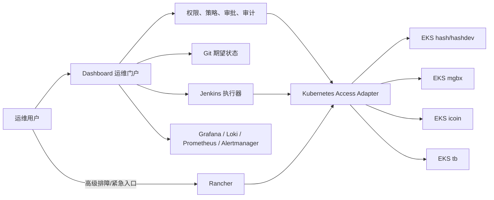
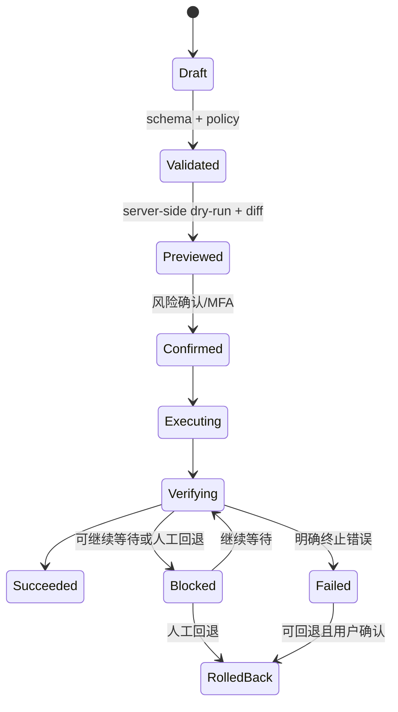

# Dashboard Kubernetes 统一运维平台开发计划

> 文档状态：方案评审稿  
> 编制日期：2026-10-12  
> 适用仓库：`dashboard`  
> 目标：在不重复建设通用 Kubernetes 管理平台的前提下，将多环境 EKS 的日常运维、发布、诊断、审计和治理统一到 Dashboard

## 1. 结论

### 1.1 推荐方案

采用 **“Rancher 管集群，Dashboard 管运维流程”** 的混合架构：

- **Rancher** 作为 Kubernetes 通用管理底座，负责多集群注册、集群/节点/Namespace/通用资源浏览、原生 RBAC 和紧急运维入口；
- **Dashboard** 继续作为运维部门统一门户，负责环境与业务映射、发布与回退、Ingress/证书/监控申请、CI/CD、告警、AI 调查、审批确认和统一审计；
- **Git + Jenkins** 继续承载声明式资源的期望状态和发布执行。Dashboard 不应发展成允许任意在线修改所有 Kubernetes YAML 的第二个集群控制面；
- **Prometheus + Alertmanager + Grafana + Loki** 继续作为观测事实源，Dashboard 聚合状态、深链和处置流程，不重写指标、日志、链路存储引擎；
- 第一版先对接现有 EKS 和现有 Dashboard 能力，不引入跨集群工作负载调度或资源联邦。

这不是简单地在 Dashboard 中嵌入 Rancher 页面。两者职责必须清晰：



### 1.2 为什么不建议完全自研

通用 Kubernetes 控制台需要长期覆盖 API discovery、CRD、watch、exec/log、节点与存储、RBAC、审计、升级兼容、安全补丁等大量基础能力。当前 Dashboard 已经有明确的业务运维价值，但不具备替代成熟集群管理平台的完整基础，也没有必要重复承担这部分维护成本。

完全自研的合理范围仅限于：

- 与公司环境、服务、租户、线路和发布流程相关的强业务能力；
- 受控模板、dry-run、Diff、确认、回滚、审计和状态跟踪；
- 对通用资源的只读聚合视图，以及少量经过白名单约束的高频动作；
- 将告警、日志、指标、发布记录和资源拓扑关联起来。

### 1.3 候选方案判断

| 方案 | 定位 | 与当前项目的适配度 | 结论 |
| --- | --- | --- | --- |
| Rancher | 多集群、项目/Namespace、RBAC、节点和通用资源管理 | 高；适合作为独立集群管理底座，Dashboard 可保留业务流程 | **推荐先试点** |
| KubeSphere | 一体化多租户、DevOps、可观测、应用管理平台 | 中；能力全面，但与现有 Jenkins、Grafana、Loki、Dashboard 流程重叠较多 | 暂不引入，除非后续决定整体平台迁移 |
| Backstage | 面向服务所有者的软件目录和开发者门户 | 中低；官方 Kubernetes 能力主要面向服务健康与资源下钻，而非集群管理员 | 不作为本次 K8s 管理底座；未来可评估服务目录 |
| Headlamp | 轻量 Kubernetes Web UI 和插件平台 | 中；适合原生资源浏览或低成本试验，但组织、项目和企业级治理弱于 Rancher | 可作为只读 UI 备选，不与 Rancher 同期引入 |
| OpenClaw 自建面板 | Agent/自动化扩展 | 低；不是成熟 Kubernetes 管理控制面 | 不作为底座；仅可作为未来受控自动化入口 |
| Dashboard 全自研 | 业务高度匹配 | 通用能力建设和长期维护成本过高 | 只自研业务流程层，不自研完整控制面 |

Rancher 官方文档明确覆盖托管 EKS 的注册、项目/Namespace、Workload、节点、存储和工具集成；项目级角色可将一组 Namespace 作为授权边界。Backstage 官方则明确说明其 Kubernetes 功能面向 service owners，而不是 cluster admins。因此两者不是同类替代品。

参考资料：

- [Rancher Cluster Administration](https://ranchermanager.docs.rancher.com/v2.12/how-to-guides/new-user-guides/manage-clusters)
- [Rancher Projects and Namespaces](https://ranchermanager.docs.rancher.com/v2.13/how-to-guides/new-user-guides/manage-clusters/projects-and-namespaces)
- [Rancher Cluster and Project Roles](https://ranchermanager.docs.rancher.com/v2.13/how-to-guides/new-user-guides/authentication-permissions-and-global-configuration/manage-role-based-access-control-rbac/cluster-and-project-roles)
- [Backstage Kubernetes](https://backstage.io/docs/next/features/kubernetes/)
- [KubeSphere Multi-cluster Management](https://www.kubesphere.io/docs/v3.3/multicluster-management/)
- [Headlamp in-cluster installation](https://headlamp.dev/docs/latest/installation/in-cluster/)

## 2. 当前仓库能力盘点

### 2.1 已有能力

当前代码已经形成平台化基础，不应推倒重来：

- 全局环境选择和 `X-Target-Environment` 环境路由；
- 基于环境 `kubeContext` 的 EKS 连接，生产端清理 kubeconfig 中静态 AWS profile/AKSK，使用 EC2 instance role 默认凭据链；
- Namespace 列表，以及 Deployment、StatefulSet、DaemonSet 查询；
- Workload 重启、Deployment 镜像历史、镜像回退、发布状态跟踪和 Pod 日志；
- Ingress 预览、编辑、dry-run、确认和创建；
- ServiceMonitor、PrometheusRule、Deployment、Service 申请及 Jenkins 执行链路；
- CI/CD 执行中心、Alertmanager 告警响应、Grafana/Loki 日志调查；
- 环境管理、账号与权限、审计日志和 SiteConf；
- 现有应用接入计划已定义 Git MR、Jenkins、Kubernetes 的受控发布方向。

### 2.2 主要缺口

| 领域 | 当前状态 | 缺口 |
| --- | --- | --- |
| 多集群目录 | 以环境配置和 kube-context 为主 | 缺少集群健康、版本、区域、节点、容量、凭据状态的统一资产模型 |
| Kubernetes RBAC | 页面有 `menu:deployments` | `deployments` 后端没有细分 read/restart/rollback/log 权限，不能只依赖前端菜单隐藏 |
| 资源覆盖 | Workload、Ingress、部分监控资源 | 缺少 Pod/Event、Service、ConfigMap、Secret 元数据、Job/CronJob、HPA/PDB、PVC、Node 等统一只读视图 |
| 写操作模型 | 分散在不同 Controller/Service | 缺少统一 dry-run、Diff、风险分类、幂等、并发保护、确认和审计协议 |
| 资源所有权 | 服务名和环境分散存在 | 缺少 service/app/team/owner 与 Kubernetes 资源、Git 路径、Jenkins Job 的稳定映射 |
| 诊断 | 发布状态、日志、AI 日志调查已存在 | 缺少 Event/condition/previous logs/资源水位/近期变更的确定性诊断包 |
| 容量治理 | 尚未统一 | 缺少 Node/Namespace CPU、内存、Pod、Quota、LimitRange、HPA 水位和趋势 |
| Secret 生命周期 | 有 KMS 变量加解密 | 不应在页面返回 Secret 明文；缺少引用、轮换状态、使用关系和到期治理 |
| 多集群实时性 | 主要是请求时读取和局部轮询 | 缺少统一 watch/cache、限流、超时、熔断和集群不可用降级 |

## 3. 目标产品边界

建议将现有“EKS 部署”逐步升级为一级能力组 **“Kubernetes 管理”**，而不是把所有内容塞进一个列表页面。

### 3.1 Dashboard 内建议页面

1. **集群总览**
   - 环境、集群、Region、Kubernetes 版本、连接状态、节点/Pod/CPU/内存水位；
   - Grafana、Rancher、AWS EKS 控制台的受控深链；
   - 只展示用户有权访问的环境。
2. **工作负载**
   - 延续现有 EKS 部署能力；统一 Deployment、StatefulSet、DaemonSet；
   - 增加 Pod、Event、condition、previous container logs 和发布历史；
   - 重启、镜像回退仍为受控动作，不开放任意 patch。
3. **服务与网络**
   - Service、Ingress、Endpoint/EndpointSlice 只读关联；
   - 新增/修改继续走现有 Ingress 专用流程，不提供任意资源编辑器。
4. **配置与密钥**
   - ConfigMap 展示元数据、键名、版本和引用关系；值编辑走 Git/MR 或受控白名单；
   - Secret 只展示名称、类型、键名、引用 Workload、更新时间和轮换状态，默认永不返回明文。
5. **弹性与容量**
   - HPA、PDB、ResourceQuota、LimitRange、PVC、节点容量水位；
   - VPA 首期只给建议，不自动应用；节点 drain/cordon 留在 Rancher。
6. **诊断中心**
   - 确定性规则诊断 Pending、CrashLoopBackOff、OOMKilled、ImagePullBackOff、probe 失败、调度失败；
   - 关联 Pod Event、当前/previous log、资源限制、节点状态、最近发布和告警；
   - AI 只总结已经采集和脱敏的证据，不直接获得 Kubernetes 写权限。
7. **变更记录**
   - 关联 Dashboard 操作、Git commit/MR、Jenkins build、Kubernetes generation/revision 和操作者；
   - 支持按环境、namespace、资源和时间查询。

### 3.2 保留在 Rancher 的能力

- 集群注册、升级和生命周期管理；
- 节点 cordon、drain、label、taint；
- StorageClass、PV 和复杂 PVC 管理；
- CRD/自定义资源的通用浏览；
- ClusterRole、ClusterRoleBinding、Webhook、Admission、控制面等高危资源；
- 临时 kubectl shell、任意 YAML 编辑和高级故障处置；
- 平台管理员的紧急访问入口。

### 3.3 明确不做

- 不复制一套 Rancher/KubeSphere；
- 不让浏览器持有 kubeconfig、Rancher Token、AWS AKSK 或 Kubernetes ServiceAccount Token；
- 不允许模型生成并直接执行 kubectl、任意 YAML 或任意 API 请求；
- 不在 Dashboard 数据库保存 Secret 明文；
- 不把“多集群统一管理”解释为跨集群调度、KubeFed 或自动迁移 Workload；
- 不让用户在 Dashboard 和 Rancher 同时修改同一声明式资源而没有所有权规则。

## 4. 技术架构

### 4.1 Kubernetes 访问层

在现有 `KubernetesService` 上方新增统一的 `KubernetesAccessAdapter`，业务模块不再自行拼接任意 Kubernetes API 调用：

```text
KubernetesAccessAdapter
  resolveCluster(environmentId)
  authorize(actor, environmentId, namespace, resource, verb)
  read(resourceRef)
  list(query + pagination + budget)
  collectDiagnosticBundle(resourceRef)
  dryRun(changeSet)
  diff(changeSet)
  executeApprovedAction(actionId)
```

访问实现首期仍可复用当前 kubeconfig + EKS exec token 链路。生产身份继续使用 EC2 instance role / target role 与 EKS Access Entry，不恢复数据库 AKSK。Rancher 接入后，不要立即把 Dashboard 所有 API 流量改走 Rancher；先做独立适配器 PoC，对比：

- 直连 Kubernetes API：链路短、沿用现状，但需要自行处理多集群访问与 Kubernetes RBAC；
- Rancher API/代理：统一多集群入口与 RBAC，但增加平台依赖和 Token 生命周期管理。

最终可以按动作选择：Dashboard 高频受控动作直连 Kubernetes API，通用资源浏览和高级管理跳转 Rancher。无论走哪条链路，前端只调用 Dashboard 后端。

### 4.2 集群与资源目录

新增稳定的服务端目录，不允许客户端自行提供 API Server URL、Rancher cluster ID 或 credential：

```text
KubernetesClusterProfile
  environmentId, clusterId, displayName, provider, accountId, region
  kubeContext, rancherClusterId?, enabled, production
  allowedNamespaces, credentialRef, lastProbeAt, health

KubernetesResourceOwnership
  environmentId, namespace, apiVersion, kind, name
  appId, serviceId, ownerTeam, repository, branch, manifestPath
  deliveryMode, jenkinsJob, managedBy
```

`deliveryMode` 至少区分：

- `gitops`：只能通过 Git/MR/Jenkins 修改；
- `dashboard-action`：允许 Dashboard 执行固定动作，如 restart/rollback；
- `external-managed`：只读并跳转外部平台；
- `unmanaged`：只读告警，禁止写操作，待人工认领。

### 4.3 权限模型

菜单权限只决定可见性，后端必须对每个 API 再做授权。建议新增：

```text
menu:kubernetes
kubernetes:cluster:read
kubernetes:workload:read
kubernetes:workload:restart
kubernetes:workload:rollback
kubernetes:pod:logs
kubernetes:diagnose
kubernetes:network:read
kubernetes:config:read-metadata
kubernetes:capacity:read
kubernetes:change:propose
kubernetes:change:approve       # 后续审批占位
kubernetes:admin-link
```

权限判定必须同时满足：用户权限、环境范围、namespace 范围、资源类型、verb 和资源所有权。生产环境写操作可以追加 MFA/OTP、显式风险确认和双人审批；第一版至少应保留审批状态字段，但可以继续使用现有“权限 + 最终确认”模式。

### 4.4 写操作统一协议

所有新写操作使用相同生命周期：



每个动作必须具备：幂等键、资源版本或 Git commit 并发校验、dry-run、Diff、超时、取消/回退边界、状态持久化、服务端权限校验和审计。禁止新增只在 HTTP 请求内同步等待十分钟的实现。

### 4.5 诊断规则

首期采用确定性诊断，不先做“AI 自动修复”：

| 现象 | 最小证据 |
| --- | --- |
| Pending | Pod condition、scheduler Event、PVC、节点 selector/taint、Quota |
| CrashLoopBackOff | waiting/terminated state、exit code、restart count、current/previous logs、probe |
| OOMKilled | terminated reason、limits/requests、当前用量与近期峰值 |
| ImagePullBackOff | image、imagePullSecret 引用、Event 原因；不返回 Secret 内容 |
| probe 失败 | probe 配置、Event、容器端口、启动耗时、近期发布 |
| rollout 卡住 | generation、replicas、conditions、Pod 分布、Event、PDB/Quota |

诊断结果分为“事实”“规则推断”“建议”，每项带资源 UID、时间和证据引用。AI 项目日志调查可在后续接收此脱敏诊断包进行总结，但不能绕过权限采集额外资源。

## 5. 分阶段开发计划

### Phase 0：范围冻结与 Rancher PoC（必须）

任务：

- 盘点每个环境的 EKS cluster ARN、account、region、kube-context、EKS Access Entry、Namespace 和生产属性；
- 建立当前 API 能力、Kubernetes verb、AWS/IAM 与实际 RBAC 权限矩阵；
- 在一个非生产 EKS 注册 Rancher，验证只读用户、项目/Namespace 隔离、资源浏览、审计和深链；
- 明确 Rancher 的部署位置、HA、备份、OIDC/SSO、证书、升级和失联时的应急方案；
- 选定“Dashboard 直连”和“Rancher 代理”的最终边界；
- 选一个低风险 Namespace 作为试点。

验收：

- Rancher 故障不影响 EKS 工作负载运行；
- 试点用户看不到未授权集群/Namespace；
- Dashboard、Rancher 和 kubectl 三条访问路径的身份与审计归属可解释；
- 不引入静态 AWS AKSK，不把 kubeconfig/Token 返回浏览器。

### Phase 1：安全基线与统一访问层（必须）

任务：

- 为现有 deployments/logs 等后端 API 增加细粒度服务端权限；
- 实现 `KubernetesClusterProfile`、环境/集群映射和连通性探测；
- 封装 `KubernetesAccessAdapter`、超时、并发限制、错误分类、审计上下文；
- 建立 read/restart/rollback/log 最小 Kubernetes RBAC；
- 自动化测试覆盖跨环境、跨 Namespace、无权限、凭据缺失和集群不可用。

验收：菜单 URL 或 API 直调不能绕过权限；环境 A 不能使用环境 B 身份；所有写操作能关联操作者、环境、Namespace 和资源 UID。

### Phase 2：Kubernetes 总览与只读资源中心（必须）

任务：

- 新增集群总览、容量水位和连接状态；
- 工作负载页补充 Pod、Event、condition、容器状态和 previous logs；
- 增加 Service/Endpoint、Ingress、HPA/PDB、Quota/LimitRange、PVC 的只读关系；
- Secret 仅返回元数据、键名和引用关系；
- 所有列表支持服务端分页、Label/字段白名单过滤和查询预算。

验收：能从集群 → Namespace → Workload → Pod → Event/log 完成下钻；大集群不会一次拉取全量对象；无权限数据不出现在数量统计和搜索结果中。

### Phase 3：确定性异常诊断（推荐作为第一版交付）

任务：

- 实现 Pending、CrashLoopBackOff、OOMKilled、ImagePullBackOff、probe 和 rollout 诊断器；
- 关联 Prometheus/Grafana/Loki、Alertmanager 和 Dashboard 发布记录；
- 输出证据包、风险级别和下一步建议；
- 提供 Rancher/Grafana/日志的受控深链。

验收：使用脱敏故障样例和至少一次非生产真实故障验证；诊断不得把 probe 启动期暂态直接判为终止失败；无证据时明确返回“证据不足”。

### Phase 4：统一变更协议与模板化资源（推荐）

任务：

- 抽取现有 restart、rollback、Ingress、监控申请的统一 Action/Change 状态机；
- 新增 server-side dry-run、Diff、资源版本并发保护、确认和回退元数据；
- Deployment/StatefulSet 发布继续交给 CI/CD；HPA/PDB/Quota 等优先走 Git/MR/Jenkins；
- 页面明确资源由 Dashboard、GitOps、Rancher 还是外部系统管理。

验收：不存在无预览的新写操作；重复请求不重复变更；冲突资源不会盲目覆盖；失败、受阻、继续等待和回退生命周期可审计。

### Phase 5：容量和生命周期治理（后续增强）

- Namespace/节点容量趋势、requests/limits 覆盖率和热点；
- HPA 建议、VPA recommendation 展示，首期不自动应用 VPA；
- Secret/证书只做引用、到期和轮换状态治理；
- PVC 使用率、孤儿资源、长期 Pending/Completed Job、无 owner 资源治理；
- 周期性治理报告和负责人通知。

### Phase 6：平台增强（可选）

- SSO/OIDC 用户组与 Dashboard/Rancher 权限映射自动化；
- Policy-as-code（Kyverno/Gatekeeper）结果展示；
- Argo CD/Flux 等 GitOps 控制器评估；
- 多环境批量只读比较；
- 经审批的自动修复，仅限固定 runbook，不开放任意 Agent 写集群。

## 6. 第一版冻结范围

建议第一版以 **Phase 0 至 Phase 3** 为冻结目标：

- 一个非生产环境完成 Rancher PoC；
- 所有 Kubernetes API 有服务端权限和环境/Namespace 边界；
- 集群、Workload、Pod、Event、Service/Ingress、基础弹性和容量只读下钻；
- 保留现有重启、镜像回退、日志和发布状态能力；
- 六类高频异常的证据化诊断；
- 与 Grafana/Loki、Alertmanager、CI/CD、Rancher 的受控深链；
- 自动化测试、审计、错误分类和降级行为完整。

第一版不要求：任意 YAML 在线编辑、节点操作、Secret 明文、完整审批流、跨集群调度、自动修复、VPA 自动应用、KubeSphere/Backstage 迁移。

## 7. 风险与控制

| 风险 | 控制措施 |
| --- | --- |
| Dashboard 与 Rancher 双写冲突 | 资源所有权和 `deliveryMode`；声明式资源以 Git 为准 |
| 平台身份权限过大 | read/action 分离；按环境/Namespace/verb 最小权限；生产身份独立 |
| Rancher 成为新的关键依赖 | Dashboard 高频动作不强制依赖 Rancher；Rancher HA、备份和失联预案 |
| 列表/Watch 压垮 API Server | 分页、缓存、查询预算、限流、熔断；禁止全 Namespace 无界 watch |
| Secret 泄露 | 只显示元数据/键名/引用；禁止日志、审计、响应和 LLM 上下文包含值 |
| 前端权限绕过 | 所有 API 服务端二次鉴权；自动化测试直调 API |
| AI 误操作 | AI 只消费脱敏证据并给建议；写操作必须进入固定 Action 状态机 |
| 开源平台供应链/升级风险 | 固定版本、测试环境升级、备份恢复演练、插件最小化、漏洞扫描 |

## 8. 测试策略

1. **单元测试**：授权矩阵、环境解析、资源过滤、错误分类、诊断规则、脱敏和状态机；
2. **契约测试**：使用固定 Kubernetes API fixtures 覆盖不同版本和资源缺字段；
3. **集成测试**：使用 kind/k3d 建立正常、Pending、CrashLoop、OOM、拉镜像失败和 probe 失败场景；
4. **安全测试**：API 直调、跨环境、跨 Namespace、恶意 selector、SSRF、日志注入、Secret 泄露；
5. **真实链路测试**：只在非生产集群验证 EKS token、Rancher RBAC、Event/log、Prometheus/Loki 深链和固定写动作；
6. **回归测试**：现有 EKS 部署、Ingress、监控申请、CI/CD、Oncall、AI 日志调查不得退化。

## 9. 实施前决策清单

进入业务代码开发前，需完成以下决策：

- Rancher 部署在独立管理集群还是现有运维集群；
- 首个非生产试点环境和 Namespace；
- SSO/OIDC 身份源与紧急本地管理员保管方式；
- Dashboard 高频动作直连 Kubernetes API，还是通过 Rancher 代理；
- 资源所有权的事实源是现有服务目录、Git 路径还是新增映射表；
- 生产环境是否在第一版开放 restart/rollback，还是只读；
- 监控指标中的容量阈值和数据保留期；
- Rancher 版本、升级窗口、备份和恢复责任人。

这些决定不影响先完成 Phase 0 的只读盘点和 PoC，但必须在 Phase 1 合并前冻结。
