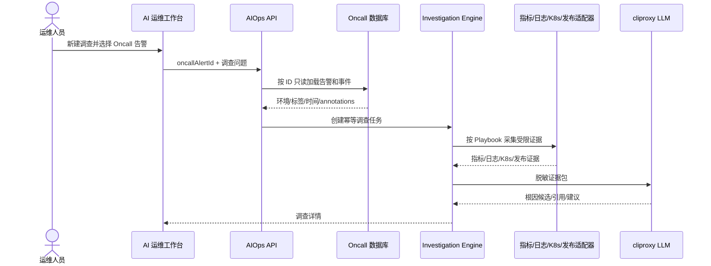

# 告警驱动的 AI 运维统一调查工作台开发计划

> 日期：2026-10-13
>
> 状态：Phase 0～2 已完成本地实现与隔离链路验证；待人工验收后进入 Phase 3
>
> 适用仓库：`/Users/liuzelin/github/dashboard`

## 0. 实施状态（2026-10-13）

Phase 0、Phase 1 和 Phase 2 的本地代码已经完成：

- `/ai-ops` 已改为告警调查任务首页；调查详情、主动日志调查和 SQL 助手使用独立内部路由；
- 新增 Alertmanager 结构化 webhook、专用 Bearer Token、告警白名单、payload/标签数量限制；
- 新增 Investigation、Step、Evidence、Feedback 持久化表和数据库迁移；
- 实现 fingerprint + startsAt + playbook version 幂等、firing/resolved 更新和通用告警报告；
- 用户页面权限统一沿用 `menu:ai-ops`；
- Oncall 页面和运行时代码未改动；
- 后端全量 135 条测试、后端构建、前端构建以及本次新增文件的定向 lint 已通过。
- 已保存两条脱敏回放 fixture，并实现固定、不可由模型改写的 PromQL 专项证据采集；
- `KylinBackendServiceHttpLatencyHigh` 会关联服务延迟、服务请求速率、慢 URI 和 URI 请求速率，能够单独标记 `LOW_TRAFFIC_SLOW_URI`；
- `CPUThrottlingHigh` 会关联 throttling、CPU usage、CPU limit 和重启次数；影响证据不完整时保持 `OBSERVE`，不会直接建议扩容；
- 已使用隔离的本地 MySQL 8.4 和本地后端完成 webhook 创建、重复投递幂等、Prometheus 历史证据落库、列表、详情和反馈 API 验证；
- 2026-10-13 重启常规开发服务后，已在当前后端 `.env` 指向的开发数据库执行四张 AIOps 调查表迁移；生产数据库仍未迁移。

Phase 3 暂不提前开启。原因不是代码或环境阻塞，而是本计划明确要求先由人工核对两条真实案例的证据与判断，再接入 Kubernetes、发布记录及告警群回传。群回传属于外部可见行为，继续保持关闭。

尚未执行生产数据库迁移，也未修改线上 Alertmanager route/receiver，因此真实告警还不会自动进入 AI 运维。生产接入需要后续单独配置 `aiops.alertmanager.bearer_token`，执行生产迁移，并将两条白名单告警以并行 receiver 投递到 `/api/ai-ops/events/alertmanager`。

## 1. 决策结论

本次改造只调整现有菜单 **“AI 运维”**，不修改 Oncall 告警、监控申请、CI/CD 执行中心、EKS 部署等已有菜单页面，也不新增侧边栏菜单。

当前核心目标是针对**运维告警群实际收到的 Prometheus / Alertmanager 告警**，自动采集指标、日志、Kubernetes 和发布证据，生成可追溯的初步判断、根因候选与排查建议，减少值班人员在多个系统间手工检索的时间。主动日志调查、UID/仓位 ID/订单 ID 查询和 SQL 助手保留，但不是首期主线。

“AI 运维”不再以继续追加 Card 的方式承载新功能，而是改造成以告警调查为首页的统一工作台。完整的证据采集、根因候选、时间线和建议全部在 AI 运维内部展示。

确认后的边界如下：

- Oncall 继续负责 Alertmanager 告警接收、去重、`FIRING / ACKED / RESOLVED` 生命周期、通知、ACK、升级和值班；其前端页面不改。
- AI 运维负责调查任务、证据采集、关联分析、根因候选、排查建议、人工反馈和调查审计。
- AI 运维优先接收 Alertmanager 按试点白名单并行投递的结构化事件，也可以只读复用 `oncall_alerts`、`oncall_alert_events`；它不反向修改 Oncall 状态、ACK、通知或升级记录。
- 告警群是通知和结果触达入口，不是机器解析的数据源。禁止通过抓取 Lark 群消息或让模型解析告警文本来替代 Alertmanager 结构化 webhook。
- 权限只沿用现有 `menu:ai-ops` 菜单权限，不增加场景级、工具级或来源级权限。
- 首期只读，不自动回滚、扩缩容、重启 Pod、修改告警规则或执行 SQL。

## 2. 当前实现与改造原因

当前 `/ai-ops` 页面已实现：

- 受控项目日志调查；
- 脱敏证据、证据 ID 和 Grafana Explore 链接；
- AI SQL 草稿预览；
- SQL 审计列表。

当前页面采用多个纵向 Card 顺序堆叠。继续加入告警调查、Kubernetes 异常、发布回溯、调查历史、反馈和证据时间线后，会造成入口混杂、状态难以保存、调查详情过长，也无法支持后台调查任务。因此本次应先重构信息架构，再增加场景。

2026-10-13 18:18（Asia/Tokyo）已从 `https://prometheus.pre.mg56.net` 和 mgbx EKS 只读确认两条真实历史告警，可作为首批开发基线：

- `KylinBackendServiceHttpLatencyHigh`，`warning`，业务服务延迟类告警；
- `CPUThrottlingHigh`，`info`，Kubernetes 容器 CPU throttling 类告警。

Prometheus 当前已显示两条规则为 `inactive`，但查询 2026-10-13 对应时段的 `ALERTS` 历史序列可以确认它们曾进入 firing。JVM 告警目前没有真实历史样本，只作为合成告警和演练案例，不作为首期真实效果指标。

本次不改变现有安全契约：

- 环境继续由 `X-Target-Environment` 确定；
- 模型不持有 Grafana、Kubernetes、AWS 或数据库凭据；
- 模型只能生成结构化计划，后端代码校验并执行只读工具；
- 日志、告警 annotations 等外部文本均按不可信输入处理；
- 结论必须引用实际证据，证据不足时明确返回“证据不足”。

## 3. 产品信息架构

侧边栏仍保留一个入口：

```text
运维工具
└── AI 运维                 /ai-ops
```

AI 运维内部使用路由化工作台，不新增侧边栏菜单：

```text
/ai-ops
├── 调查任务列表与概览
├── /investigations/new     新建调查
├── /investigations/:id     调查详情
└── /tools/sql              SQL 助手（保留既有能力）
```

这些路径是 AI 运维内部视图，不注册新的菜单项，也不影响菜单排序管理。

### 3.1 AI 运维首页

首页从“功能表单集合”改为“调查任务中心”，包含：

1. 顶部摘要：待调查、调查中、已完成、证据不足、失败。
2. 告警调查列表：告警名称、级别、环境、服务/Pod、开始时间、调查状态、根因摘要、置信度和耗时。
3. 筛选项：调查状态、告警名称、级别、时间范围、服务或关键字。
4. 主操作“新建主动调查”，作为告警之外的补充入口。
5. 次级入口“SQL 助手”，不再把 SQL 表单和审计表直接铺在首页。

调查来源类型定义为：

- `ALERTMANAGER_ALERT`：Alertmanager 直接投递的结构化告警，首期主来源；
- `ONCALL_ALERT`：关联已进入现有 Oncall 数据库的告警；
- `MANUAL`：用户主动描述问题或输入业务线索；
- `K8S_ANOMALY`：从调查表单指定 Kubernetes 对象；
- `RELEASE_REVIEW`：围绕发布记录调查影响。

### 3.2 新建调查

新建调查采用一个统一表单，根据来源逐步展示必要字段：

- 当前环境：读取全局环境上下文，不允许表单覆盖 Header；
- 来源：Alertmanager 历史告警、Oncall 告警、主动调查、K8s 异常、发布回溯；
- 项目/日志源、Namespace、服务；
- 时间范围；
- 自然语言问题；
- UID、仓位 ID、订单 ID、trace ID 或错误码等可选线索；
- 选择告警时，从 AI 运维页面内部读取当前环境的 AIOps/Oncall 历史告警列表。

选择 `ONCALL_ALERT` 后，浏览器只提交 `oncallAlertId`。后端必须重新读取告警记录，不接受客户端传入的 labels、annotations、环境、告警名称或时间，以避免上下文被篡改。

### 3.3 调查详情

调查详情使用独立内部路由，避免在首页展开大段结果。建议由以下区域组成：

1. **调查摘要**：状态、来源、环境、服务、调查时间范围、创建人。
2. **结论**：根因候选、置信度、证据充分性、影响范围。
3. **证据时间线**：告警、指标、日志、Kubernetes Event、发布记录按时间排序。
4. **证据详情**：Evidence ID、来源系统、脱敏内容、原始系统深链。
5. **未确认事项**：缺失数据和不能证明的推断。
6. **建议动作**：仅生成排查、回滚评估或扩容评估建议，不直接执行。
7. **调查过程**：已执行工具、查询摘要、耗时、失败原因。
8. **人工反馈**：有效、部分有效、无效、证据不足，并允许填写备注。

页面状态建议使用：

```text
PENDING -> COLLECTING -> ANALYZING -> COMPLETED
                              ├── INSUFFICIENT_EVIDENCE
                              └── FAILED
```

`INSUFFICIENT_EVIDENCE` 是有效业务结果，不应显示成系统错误。

### 3.4 SQL 助手迁移

现有 SQL 助手继续保留“只生成/预览、不执行”的契约，但迁移到 `/ai-ops/tools/sql`：

- 保留自然语言生成 SQL、直接输入 SQL、风险识别和 LIMIT/超时控制；
- 保留最近 SQL 审计；
- 不与故障调查结果混在同一个长页面；
- 不把 SQL 执行能力纳入本次开发。

## 4. 业务链路

### 4.1 告警群与 AI 调查的推荐接入链路

```text
Prometheus rule
      │
      ▼
Alertmanager
      ├── 现有 receiver ──> 运维告警群
      └── AIOps receiver ─> Dashboard AIOps webhook
                                  │
                                  ▼
                         白名单、去重、调查任务
                                  │
                                  ▼
                       AI 运维页面 / 可选群内摘要
```

首期不替换现有告警通知 receiver。Alertmanager 对试点告警使用 `continue: true` 或等价并行路由，在正常发往告警群的同时向 Dashboard AIOps webhook 投递同一结构化事件。

不能只依赖现有 `oncall_alerts`：Oncall 可能只接收特定高风险路由，而真实试点包含 `warning` 和 `info`。AIOps 应有独立事件接收与幂等能力；若相同 fingerprint 已存在 Oncall 记录，只保存关联 ID，不复制或修改 Oncall 生命周期。

首期 AI 结果只在 AI 运维页面展示。群内回传放在后续阶段，只对试点告警发送一条简短的“AI 初步调查”摘要和 Dashboard 详情链接；不得重复发送原始告警，不得把根因候选写成已确认根因。

### 4.2 关联 Oncall 告警的调查



不修改 Oncall 前端，不在 Oncall 页面增加按钮、状态或 AI 摘要。用户需要从 AI 运维的“新建调查”中选择告警，或由后端白名单规则自动创建调查。

### 4.3 主动调查

用户可以不关联告警，直接提交现象和线索。后端根据环境、项目、服务、时间范围和线索创建调查。已有日志调查能力作为第一个证据适配器复用，不重新实现 Grafana/Loki 查询。

### 4.4 自动调查

试点告警的自动创建是首期核心链路，但先采用“影子模式”：自动接收、自动取证、自动生成页面报告，不向告警群回传，也不执行任何处置。

- Alertmanager 通过独立 receiver 将白名单告警并行投递给 AIOps；
- AIOps 只对明确的环境、告警名和 Playbook 白名单自动创建调查；
- 幂等键建议为 `environment_id + fingerprint + startsAt + playbook_version`；
- 同一告警已有进行中或已完成调查时不重复调用模型；
- 告警恢复只追加时间线证据，不自动删除或覆盖调查结论；
- 必须设置并发、超时、每日模型调用量和日志扫描预算。

人工选择历史告警重新调查作为回放和兜底路径。影子模式验收稳定后，再单独开启群内摘要回传。

## 5. 推荐后端结构

保持 `AiOpsModule`，在模块内部按职责拆分：

```text
ai-ops/
├── ai-ops.controller.ts
├── investigation/
│   ├── investigation.controller.ts
│   ├── investigation.service.ts
│   ├── investigation.repository.ts
│   ├── investigation-runner.service.ts
│   └── investigation.types.ts
├── playbooks/
│   ├── playbook.registry.ts
│   ├── kylin-http-latency.playbook.ts
│   ├── cpu-throttling.playbook.ts
│   ├── generic-prometheus-alert.playbook.ts
│   ├── jvm-heap-synthetic.playbook.ts
│   ├── pod-oom.playbook.ts
│   ├── http-error-rate.playbook.ts
│   └── generic-log.playbook.ts
├── tools/
│   ├── prometheus.tool.ts
│   ├── logs.tool.ts
│   ├── kubernetes.tool.ts
│   ├── release.tool.ts
│   ├── alertmanager-source.tool.ts
│   └── oncall-source.tool.ts
└── sql/
    └── 现有 SQL 预览能力
```

关键职责：

- `InvestigationService`：创建、查询、反馈和幂等控制；
- `InvestigationRunner`：状态流转、超时和工具编排；
- `PlaybookRegistry`：按告警类型或调查类型选择确定性调查模板；
- `Tools`：只执行有限的只读查询，不向模型暴露凭据和任意 URL；
- LLM：生成结构化计划、归纳证据和输出候选结论，不直接调用基础设施。

首期可继续在现有 backend 进程中异步运行。只有在调查量、执行时间或多副本一致性成为实际问题后，再拆独立 Worker；不要在 MVP 阶段提前增加常驻服务。

## 6. 数据模型

建议新增通用调查表，不把调查结果写回 `oncall_alerts`：

### 6.1 `aiops_investigations`

| 字段 | 用途 |
|---|---|
| `id` | 调查 ID |
| `environment_id` | 环境边界 |
| `source_type` | `ALERTMANAGER_ALERT / ONCALL_ALERT / MANUAL / K8S_ANOMALY / RELEASE_REVIEW` |
| `source_id` | 来源记录 ID；主动调查可为空 |
| `project_id` | 项目或日志源映射 |
| `namespace` / `service_name` | 调查范围 |
| `question` | 用户问题 |
| `status` | 调查状态 |
| `playbook_key` / `playbook_version` | 使用的调查模板 |
| `summary` | 结论摘要 |
| `confidence` | `LOW / MEDIUM / HIGH` |
| `insufficient_evidence` | 是否证据不足 |
| `created_by` | 发起人 |
| `started_at` / `completed_at` | 执行时间 |
| `error_code` / `error_summary` | 脱敏失败信息 |

### 6.2 `aiops_investigation_evidence`

保存证据编号、类型、来源、观察时间、脱敏内容、标签摘要、查询摘要和深链。原始大体量日志不应无限写入平台数据库；只保存受限、脱敏、可追溯的证据片段。

### 6.3 `aiops_investigation_steps`

记录每个 Playbook 步骤的状态、工具、开始/结束时间、结果数量和失败摘要，用于页面进度与运维排障。

### 6.4 `aiops_investigation_feedback`

记录人工评价和备注，为后续离线评测、Playbook 调整和模型升级提供数据。反馈不直接训练模型，也不能覆盖原始调查记录。

## 7. API 设计

所有用户接口沿用 `menu:ai-ops` 权限和现有登录身份；不新增 `aiops:*` 细粒度权限。环境相关接口继续要求 `X-Target-Environment`。

```text
GET    /api/ai-ops/investigations
POST   /api/ai-ops/investigations
GET    /api/ai-ops/investigations/:id
POST   /api/ai-ops/investigations/:id/retry
POST   /api/ai-ops/investigations/:id/feedback
GET    /api/ai-ops/investigation-sources/oncall-alerts
GET    /api/ai-ops/investigation-options
POST   /api/ai-ops/events/alertmanager
```

`POST /api/ai-ops/events/alertmanager` 使用独立 webhook Bearer Token 或现有安全配置模式，不使用用户菜单会话；它只接收 Alertmanager 标准 payload，限制 body 大小、告警数量、标签数量和字段长度。用户页面接口仍只使用 `menu:ai-ops`。

重新调查一条已接收告警的示例：

```json
{
  "sourceType": "ALERTMANAGER_ALERT",
  "sourceId": 123,
  "question": "分析 Kylin backend 延迟告警是整体退化还是单个低频接口导致"
}
```

后端校验要求：

- `sourceId` 必须存在；
- 来源告警的 `environment_id` 必须与 Header 环境一致；
- 当前环境必须存在可用的指标、日志或 Kubernetes 数据源配置；
- 不返回 Oncall 原始 webhook payload；
- retry 创建新 run 或增加 attempt，不覆盖旧证据和旧结论；
- 列表和详情按当前环境过滤，不能由 query/body 绕过。

## 8. 首批 Playbook

### 8.1 `KYLIN_BACKEND_HTTP_LATENCY_HIGH`：真实主试点

匹配告警：`KylinBackendServiceHttpLatencyHigh`。

2026-10-13 只读快照：

- 告警级别为 `warning`，规则健康，当前为 `inactive`；
- 规则以 `http_server_requests_seconds_sum / count` 计算服务级 5 分钟平均非 actuator 延迟，阈值为 9 秒，持续 5 分钟触发；
- 历史 firing 样本对应 `job/service=kylin-tenant-kylin-tenant-impl`；
- 在调查窗口内，`GET /tenant/admin/channel/position/listLogs/excel` 曾出现约 146 秒的 5 分钟平均耗时，但请求速率约为每秒 `0.0069`，属于低流量慢请求，不能只根据单个均值断言整个服务持续变慢；
- 集群中该 Deployment 当前健康；同一镜像在告警后约 5 分钟出现新的 ReplicaSet/Pod，属于需要关联的变更线索，但不能仅凭时间接近断言其为根因或修复动作。

Playbook 必须采集：

- 告警规则、阈值、`for` 时间和 firing/resolved 时间；
- 服务级平均延迟、请求量、错误率和 P95/P99（存在 histogram bucket 时）；
- 按 URI、method、status 拆分的耗时与请求量，识别低频长任务、导出接口和高流量普遍退化；
- 对应 Pod 的 CPU、内存、重启、Ready、副本变化和 Kubernetes Event；
- 告警窗口前后的 ReplicaSet、镜像、发布记录和配置变更；
- 相关错误日志、慢查询、下游依赖和 trace（数据存在时）；
- 同服务其他实例以及同类接口的对比。

输出必须区分：

- 服务整体退化；
- 单 URI/低频长请求拉高平均值；
- 下游、数据库或网络等待；
- 发布或扩缩容的时间相关线索；
- 指标不足，无法判断。

不得只根据服务级平均值输出“服务故障”或“建议回滚”。

### 8.2 `CPU_THROTTLING_HIGH`：真实主试点

匹配告警：`CPUThrottlingHigh`。

2026-10-13 只读快照：

- 告警级别为 `info`，规则健康，当前为 `inactive`；
- 规则计算 5 分钟 CPU throttled periods 比例，阈值为 25%，持续 15 分钟触发；
- 历史 firing 样本包含 `monitoring/node-exporter-qn6kk`，当时源指标约为 33%；
- 该 Pod 当前 `Running / Ready`、零重启，CPU request 为 `100m`、limit 为 `500m`；同一 DaemonSet 的其他实例也使用相同资源配置；
- 现有规则包含排除 node-exporter 的 `unless` 条件，但历史仍产生 node-exporter 告警。2026-10-13 18:18（Asia/Tokyo）查询时，Prometheus 存在 kube-state-metrics 数据，却没有 node-exporter 对应的 `kube_pod_container_info` 序列，因此该 `unless` 排除向量无法命中 node-exporter。这是“规则降噪失效候选”的真实证据，不应被解释为业务故障。

Playbook 必须采集：

- throttled ratio、CPU usage、CPU request/limit；
- throttling 是否持续、是否只发生在单 Pod/单节点；
- Pod Ready、restart、OOM、Event 和节点压力；
- 对业务延迟、错误率、抓取成功率是否存在可观察影响；
- 同 DaemonSet/Deployment 其他副本对比；
- 规则排除条件实际参与匹配的 labels；
- 最近资源配置或版本变更。

输出优先分类为：

- `ACTIONABLE`：持续 throttling 且存在业务或组件功能影响；
- `OBSERVE`：存在 throttling，但尚无功能影响，需要继续观察；
- `NOISE_CANDIDATE`：平台组件、低严重级别、无影响或规则排除疑似失效；
- `INSUFFICIENT_EVIDENCE`：源指标或 Kubernetes 证据不足。

AI 只能建议检查 CPU limit、负载和规则降噪；不得自动修改资源或告警规则。

### 8.3 `GENERIC_PROMETHEUS_ALERT`

用于没有专项 Playbook 的真实告警，至少完成：规则解释、当前/历史状态、实体定位、同类对比、Kubernetes 健康、最近发布和证据不足说明。它不追求自动根因，只生成标准化初步调查报告，并收集反馈决定是否值得新增专项 Playbook。

### 8.4 `JVM_HEAP_HIGH_SYNTHETIC`：合成演练

JVM heap 暂无真实历史告警，不进入首期真实准确率或 MTTR 指标。通过非生产环境或离线 fixture 构建以下场景：

- heap 持续增长且 Full GC 后不回落；
- 容器 OOM 但 JVM heap 证据不足；
- 发布后指标同步恶化；
- 告警触发但没有足够日志或 GC 指标。

采集仍包括：

- JVM heap、Old Gen、GC 次数和停顿趋势；
- Pod memory working set、limit、restart；
- OOMKilled、Evicted、Probe failure 和 Kubernetes Event；
- HTTP 错误率、延迟；
- 告警窗口内最近发布、镜像和配置变更；
- 同服务其他 Pod 的对比。

只输出根因候选：内存泄漏、heap 配置不足、容器 limit/native memory、单实例异常或发布关联。没有 heap dump 时不得声称已定位具体泄漏对象。待获得真实告警后再转为正式 Playbook。

### 8.5 `POD_OOM`

重点区分 JVM heap、native memory、sidecar、容器 limit、节点压力和突发流量，并检查 previous log、Pod Event 和最近资源配置变更。

### 8.6 `HTTP_ERROR_RATE_HIGH`

关联入口错误率、下游依赖、日志错误模式、Trace、发布和外部依赖健康；只有时间相关不能直接表述为因果关系。

### 8.7 `GENERIC_LOG_INVESTIGATION`

复用现有日志调查，支持服务异常、错误文本、UID、仓位 ID、订单 ID 和 trace ID 等线索。继续限制 namespace、服务、时间和返回数量，并由后端编译查询。

## 9. 前端改造范围

只改造 AI 运维相关文件和新增其内部组件：

- 将当前 `AiOpsPage.tsx` 降为路由容器或工作台首页；
- 新增调查列表、调查表单、调查详情、证据时间线、调查步骤和反馈组件；
- 将 SQL 助手拆到内部路由组件；
- 保留现有 API 能力并在迁移后删除首页重复渲染；
- 为调查列表、详情和 SQL 工具分别使用独立 loading/error 状态；
- 环境变化时清空当前筛选、表单候选和跨环境详情状态；
- 调查详情必须能刷新恢复，不能只依赖 React 内存中的上一次响应。

明确不改：

- `OncallPage.tsx`；
- Oncall 菜单、权限和 API 契约；
- Oncall ACK、通知、升级和值班配置；
- 其他已有菜单页面；
- 侧边栏菜单数量和排序。

## 10. 分期实施

### Phase 0：契约与页面骨架

- 固化 Alertmanager payload、调查状态、来源类型、Playbook、证据和错误码；
- 保存两条真实告警的脱敏 webhook/指标 fixture，并记录查询时间窗口和期望事实；
- 建立数据库迁移和 repository；
- 将 AI 运维首页、调查详情和 SQL 助手拆成内部路由；
- 保证现有日志调查和 SQL 预览能力迁移后行为不退化。

验收：侧边栏仍只有“AI 运维”；首页以告警调查为主；Oncall 页面无代码改动；两条 fixture 可稳定回放；刷新任一内部路由可正常恢复；现有日志和 SQL 能力可用。

### Phase 1：Alertmanager 接入与通用告警调查

- 新增受认证的 Alertmanager webhook、payload 限制、fingerprint 去重和白名单；
- 在不影响现有告警群 receiver 的前提下，为两条试点告警配置并行投递；生产配置变更需另行确认后执行；
- 保存 Alertmanager 事件、Investigation、Step 和 Prometheus Evidence；
- 实现 `GENERIC_PROMETHEUS_ALERT`，先完成规则解释、历史状态、实体定位和证据不足判断；
- 增加调查列表、详情和反馈；

验收：真实或回放告警不会重复创建调查；现有告警群通知不受影响；调查可查询、刷新、回看和审计；失败、告警恢复和证据不足可区分。

### Phase 2：两条真实专项 Playbook

- 实现 `KYLIN_BACKEND_HTTP_LATENCY_HIGH`，接入请求量、URI、状态码、延迟和发布/ReplicaSet 证据；
- 实现 `CPU_THROTTLING_HIGH`，接入 throttling、usage、request/limit、Pod/Node 状态和副本对比；
- 将当前一次性日志调查结果持久化并作为专项调查的日志证据工具；
- 允许从 AI 运维新建调查页选择当前环境的 Alertmanager/Oncall 历史告警重新调查；
- 模型只总结脱敏证据并输出候选结论、证据引用和缺失信息；
- 不修改 Oncall 前端和生命周期。

验收：两条真实告警均可形成专项调查报告；延迟告警能识别“低流量慢 URI”而不误报成全服务故障；CPU 告警能区分有影响、观察和噪声候选；来源、环境、时间和 Evidence ID 可追溯。

### Phase 3：证据补全与告警群结果回传

- 接入只读 Kubernetes 状态、Event、previous log；
- 接入现有 CI/CD 运行记录、版本、镜像和发布时间；
- 建立跨来源时间线；
- 为 AI 初步调查摘要增加受控群内回传开关、长度限制、幂等和详情链接；
- 群内摘要明确标注“AI 初步调查”和置信度，不重复原始告警。

验收：两条真实 Playbook 至少关联指标、Kubernetes、发布和可用日志；发布只作为候选因素，不能仅凭时间接近断言根因；关闭回传开关不影响调查和现有告警链路。

### Phase 4：扩展 Playbook 与质量运营

- 扩展 Pod OOM、HTTP 错误率等有真实样本的专项 Playbook；
- 使用 `JVM_HEAP_HIGH_SYNTHETIC` 做非生产或离线演练，不计入真实告警准确率；
- 建立历史案例评测集和回归测试；
- 统计证据覆盖率、生成耗时、反馈结果和失败类型；
- 根据人工反馈调整 Playbook，不直接开放自动生产操作。

验收：新 Playbook 必须先有真实或明确标注的合成 fixture；自动触发不产生重复调查，不影响告警群和 Oncall 接收/恢复链路；异常时可关闭自动触发并继续人工调查。

## 11. 测试与验收

### 11.1 后端

- 创建、列表、详情、重试和反馈接口测试；
- Header 环境与来源环境不一致时拒绝；
- Alertmanager webhook 鉴权失败、超大 payload、标签过多和非白名单告警；
- Oncall 告警不存在、已删除或字段缺失时返回稳定错误；
- 同一告警和 Playbook 的并发幂等；
- 工具超时、部分失败、全部失败和证据不足；
- 日志提示注入、敏感字段脱敏、结果截断；
- 模型返回非法 JSON、非法 Evidence ID 或无证据结论时拒绝或降级；
- `menu:ai-ops` 权限与审计行为回归。

### 11.2 前端

- 内部路由刷新、前进和后退；
- 环境切换后清理旧环境数据；
- 调查执行中的轮询、超时、重试和取消轮询；
- `INSUFFICIENT_EVIDENCE` 与 `FAILED` 的不同展示；
- 长日志、长标签和大量证据的折叠与分页；
- SQL 助手迁移后原有预览和审计回归；
- Oncall 页面快照或行为测试确认无变化。

### 11.3 业务验收

首批使用 1 个环境、1 至 2 个项目和下列案例验收：

1. 回放 `KylinBackendServiceHttpLatencyHigh`，识别服务级均值与低频慢 URI 的差异；
2. 回放 `CPUThrottlingHigh`，结合 node-exporter 健康和资源配置输出 `OBSERVE` 或 `NOISE_CANDIDATE`，不直接建议扩容；
3. 同一 fingerprint 重复 firing 不产生重复调查；
4. firing 后收到 resolved，时间线更新但历史调查不被删除；
5. Prometheus、Kubernetes、Grafana/Loki 任一不可用时返回部分失败，不伪造结论；
6. 使用合成 JVM heap fixture 验证证据引用与“证据不足”，并在页面明确标记“演练”；
7. 根据 UID/仓位 ID 发起主动日志调查，确认既有非告警能力没有退化。

## 12. 完成标准与非目标

### 完成标准

- AI 运维已从纵向功能堆叠页调整为可持久化的统一调查工作台；
- Oncall 页面及其职责保持不变；
- 告警群中的试点告警可通过 Alertmanager 结构化事件自动进入调查工作台；
- 告警、日志、Kubernetes 和发布证据可汇入同一调查模型；
- 每个关键结论可追溯到 Evidence ID；
- 用户可以区分事实、根因候选、建议和缺失证据；
- 权限沿用 `menu:ai-ops`，没有新增复杂权限配置；
- 所有功能保持只读，失败可见、可重试、可审计。

### 本计划非目标

- 不改造 Oncall 页面；
- 不新增侧边栏菜单；
- 不替换 Prometheus、Alertmanager、Grafana 或 Loki；
- 不构建新的指标或日志存储；
- 不允许模型执行任意 LogQL、PromQL、HTTP 请求或 Kubernetes 命令；
- 不自动回滚、扩缩容、重启、静默告警或修改生产配置；
- 不承诺 AI 输出唯一且确定的根因。

## 13. 建议开发顺序

优先实施 Phase 0 和 Phase 1，先完成页面拆分、Alertmanager 结构化接入、调查持久化和通用告警报告；随后使用 `KylinBackendServiceHttpLatencyHigh` 与 `CPUThrottlingHigh` 完成两个真实专项 Playbook。JVM heap 只作为合成演练，待出现真实历史告警后再转为正式试点。只有两条真实告警的证据模型和人工评测稳定后，才增加群内回传和更多 Playbook。
