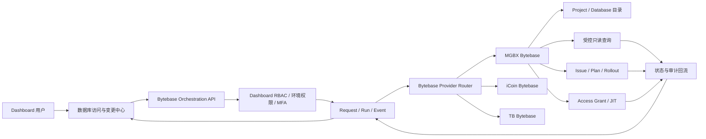

# Dashboard Bytebase 统一入口开发计划

> 日期：2026-10-15  
> 状态：hashex Phase 0、Phase 1 核心链路与 Phase 2 人工验收已完成；社区版不支持原生 JIT Grant，权限控制由 Dashboard RBAC 承担，Phase 4 原生自动授权冻结为 `UNSUPPORTED`  
> 范围：Dashboard、各环境独立 Bytebase、数据库目录/临时访问/查询/变更申请与审计  
> 约束：本计划不把数据库密码、Bytebase Service Key、SQL 查询结果或会话 Cookie 写入仓库

## 1. 结论

需求可行，推荐建设独立的 **数据库访问与变更中心**，但不建议把 Dashboard 做成共享 Bytebase Service Account 的通用 SQL 客户端。

推荐边界是：

- **Dashboard 是统一控制面**：管理用户、环境范围、动作权限、申请/审批、MFA、幂等、有效期、状态和平台审计；社区版缺失的用户授权流程由 Dashboard 管理，但不伪造 Bytebase 原生 Grant；
- **Bytebase 是数据库治理与执行面**：管理数据库目录、SQL Review、数据脱敏、访问策略、Issue/Plan/Rollout、数据库执行和原生审计；
- 每个环境绑定各自独立的 Bytebase 实例与专用机器身份，禁止用户提交任意 Bytebase URL；
- 每个 Bytebase 环境创建一组 workspace 级 Service Account；只读目录、临时访问授权、只读查询、变更提交分别使用不同最小权限身份，不用一个管理员账号覆盖全部动作；
- 在 workspace IAM 中为这些 SA 授予项目角色，使权限自动覆盖该 Bytebase workspace 的现有及未来项目；不得为方便跨项目访问而长期授予 Workspace DBA/Admin；
- 数据库写操作通过 Bytebase 原生 Issue/Plan/Rollout 执行，不由 Dashboard 使用 Service Account 直接运行任意 DDL/DML。
- Dashboard 用户不直接持有、查看或选择 Service Account；Dashboard RBAC 只授予动作权限，后端再按“环境 + 动作”选择专用机器身份。
- 第一版由管理员通过 Dashboard“账号与权限”授予普通用户目录读取和 Issue 创建权限；这些权限控制的是 Dashboard 功能入口和后端 API，不会在 Bytebase 中创建对应的最终用户身份或数据库 Grant。
- 普通用户提交 Issue，只有管理员可以在 Dashboard 内确认并触发 Rollout；正常流程不要求再次进入 Bytebase 页面。

这比“用户登录多个 Bytebase”减少了入口和授权维护成本，也避免 Dashboard 保存数据库账号密码；同时仍保留 Bytebase 的 SQL Review、脱敏、回滚和数据库审计能力。

## 2. 为什么不能直接共享一个 Service Account

如果 Dashboard 用同一个 Service Account 代理所有用户直接执行 SQL，会产生以下问题：

1. Bytebase 和数据库侧看到的主要是机器身份，原始用户归因依赖 Dashboard 自己补充，审计链变弱；
2. Service Key 泄露后的影响面等于该账号能访问的全部环境、项目和数据库；
3. Dashboard 需要自行承担 SQL 分类、权限判定、审批、脱敏、导出、超时、结果大小和写操作回退；
4. Bytebase 原生 SQL Review、风险规则、Issue 审批和 Rollout 容易被旁路；
5. 一个身份同时具备查询、授权和发布能力，不符合最小权限与职责分离。

因此，Service Account 可以作为 Provider 的机器身份，但必须按职责拆分，并由后端把 Dashboard 用户、申请单和 Bytebase 原生资源 ID 关联起来。

## 3. 已核对的现状

### 3.1 Dashboard 可复用能力

当前 CI/CD 执行中心已经具备可复用的架构模式：

- 全局环境数据源与 Dashboard RBAC；
- executor 与 environment binding 分离；
- SiteConf 引用外部系统地址和敏感凭据；
- 后端校验环境、动作、远端资源和参数，浏览器不直连外部系统；
- Run/Event 状态、幂等、并发控制、后台对账、WebSocket 状态推送和桌面通知；
- MFA、危险操作确认、日志脱敏和审计。

Bytebase 模块应复用这些**平台能力和设计方式**，但不能复用 `cicd_runs`、Jenkins Provider 或 CI/CD 状态机；数据库访问是独立业务域。

### 3.2 已知实例与 Phase 0 起点

- 已确认各环境使用彼此独立的 Bytebase 系统，不能共享 URL、Token、资源缓存或故障回退身份；
- Phase 0 首个目标为 `hashex`，连接信息来自本地私有文件 `~/Downloads/dashboard.bytebase.hashex.txt`；文件当前提供 Portal URL 和管理员 bootstrap 凭据，本计划不会记录任何密钥值；
- 管理员 bootstrap 凭据只允许本次只读 API 契约核验和后续创建专用 Service Account，不得写入 Dashboard 运行配置；
- MGBX 的历史调查结论只能作为接口探测参考，不能用于推断 hashex 的版本、许可证、角色或 API 能力；
- 当前仓库没有等价的 Bytebase 模块、菜单、权限、表或 Provider。

#### 3.2.1 hashex Phase 0 运行态快照（2026-10-15）

本轮先执行 Portal/API GET 和 `web=false` 登录契约核验；HTTPS 验证通过后，为验证职责拆分临时创建了三个项目级 Service Account，并以 etag 保护方式追加项目 IAM binding。该身份范围仅适合契约验证，不是最终运行态设计。没有创建或修改 Role、Issue、Plan、Grant、Rollout、数据库资源，也没有执行 SQL。管理员 bootstrap Token 仅存在于探测进程内存中，未写入仓库、临时文件或文档。

| 检查项 | 结果 | 判断 |
| --- | --- | --- |
| Portal | 根路径 HTTP 200 | 服务可达 |
| DNS/网络 | HTTPS 域名解析到公网 ALB；本地可达；运维侧已放行 Dashboard EC2 来源 | EC2 网络不再作为本地 Phase 1 开发阻塞项，部署验收时仍需执行应用进程 L1/L2 检查 |
| 传输安全 | TLS 1.2、受信任证书、HSTS | HTTPS 改造已生效；证书有效期至 2027-04-30 |
| 版本 | `3.21.0`，单副本 | 后续实现必须按 3.21.0 契约验证，不能直接照搬最新版 API |
| 许可证 | `FREE` | 当前只观察到 10 个内置角色；custom role 能力不能作为前提 |
| 认证 | `POST /v1/auth/login` + `web=false` 返回短期 Token | 机器认证契约成立，但当前只有管理员 bootstrap 凭据 |
| 资源目录 | 2 个 Project、4 个 Instance、49 个 Database | `hash` 为实际业务 Project；另有 Default Project |
| 数据库引擎 | MySQL、MongoDB、Redis | Provider 不能假设所有目标都是关系型数据库 |
| 治理读取 | Issue、Plan、Rollout、Database 列表均返回 200 | 资源名与分页契约可继续用于 Phase 1 fixture |
| Plan Check | 3.21.0 使用单数资源 `/v1/{plan}/planCheckRun`；change-submitter 读取返回 200 | 不可直接使用新版文档中的复数列表 endpoint |
| Access Grant | List 路由存在；Create 在功能门禁阶段返回 403 | 3.21.0 社区版不支持 JIT 写链路；Dashboard 可管理自身功能权限，但不能把它表述为 Bytebase 原生数据库授权 |
| Audit API | 正确 endpoint 为 `POST /v1/projects/{project}/auditLogs:search`，返回功能门禁 403 | Free 计划不提供 API 审计回流，不能作为第一版验收依赖 |
| Environment | `/v1/environments` 返回 404；环境信息通过 `settings/ENVIRONMENT` 和资源字段暴露 | Client 需要 3.21.0 兼容适配，不能硬编码最新版 endpoint |
| External URL | 运维侧已更新为 HTTPS 地址 | 本地 Phase 1 可继续；部署验收时重新读取 `/v1/actuator/info`，防止配置漂移 |

内置角色权限显示当前职责拆分具备可行基础：

| 目标 SA | hashex 候选内置角色 | 已观察的关键权限 | 不具备的关键权限 |
| --- | --- | --- | --- |
| reader | `roles/sqlEditorReadUser` | Project/Database get/list/schema | Issue/Plan/Rollout 创建与 TaskRun 执行 |
| change-submitter | `roles/projectDeveloper` | Sheet、Plan、Issue 创建，Plan Check；Issue/Plan/Rollout 状态读取 | `bb.rollouts.create`、`bb.taskRuns.create` |
| deployer | `roles/projectReleaser` | Rollout 创建、TaskRun 执行，Plan/Issue/Rollout 状态读取 | Issue/Plan/Sheet 创建 |

这三个角色与“普通用户提交、管理员发布”的 Dashboard RBAC 能形成双重边界。官方权限模型允许在 workspace IAM 中授予项目角色，该授权会自动继承到所有项目。因此最终运行态应为“workspace 级 SA + workspace IAM 中的最小项目角色”，而不是项目级 SA，也不是 Workspace DBA。

hashex Phase 0 曾创建以下项目级专用身份并绑定到 `projects/hash-gotn`：

- `dashboard-reader` -> `roles/sqlEditorReadUser`；
- `dashboard-change-submitter` -> `roles/projectDeveloper`；
- `dashboard-deployer` -> `roles/projectReleaser`。

这些账号属于 Phase 0 临时契约验证身份。一次性 Service Key 只写入 `~/Downloads/dashboard.bytebase.hashex.txt`，文件权限为 `0600`，未写入仓库。项目原有 IAM binding 保持不变，更新使用 etag 防止覆盖并发变更。正式接入前需先创建 workspace 级替代身份、完成等价正负向验证与凭据切换，再撤销旧 binding 并停用项目级账号；迁移不得在本计划评审阶段直接执行。

实际契约测试结果：

- 三个 SA 均可使用 `web=false` 登录并取得短期 Token；
- reader 可读取指定 Project 和 Database，读取 Issue 返回 403；
- change-submitter 可读取 Issue/Plan/Rollout，针对现有 Plan 创建 Rollout 返回 403；
- deployer 可读取 Issue/Plan/Rollout，创建 Plan 返回 403；
- 未创建测试 Issue、Plan、Rollout，未执行 SQL。

#### 3.2.2 hashex Phase 0 结论与 Phase 1 前置项

Phase 0 的版本、TLS、认证、目录、角色和负向权限契约已经完成。ALB 来源白名单与 External URL 已由运维侧处理，不阻塞本地 Phase 1。后续前置项调整为：

1. 已创建 hashex workspace 级 reader、change-submitter、deployer SA，在 workspace IAM 中分别授予 `roles/sqlEditorReadUser`、`roles/projectDeveloper`、`roles/projectReleaser`；另因 Free 版不支持 custom role 且 `bb.projects.list` 仅存在于 Workspace DBA，增加只供目录 GET 使用的独立 catalog SA；
2. 对所有现有项目验证目录、Issue、Plan 与 Rollout 权限，并新建临时空项目验证继承语义后立即清理测试项目；这属于受控人工验收，不纳入无副作用自动化测试；
3. 完成新旧凭据切换后，撤销并停用 Phase 0 的三个项目级 SA；保留脱敏迁移审计，不记录 Service Key；
4. 管理员 bootstrap 身份不得进入 Dashboard 运行配置；Phase 1 只使用职责拆分后的 workspace 级专用 SA；
5. 从 Dashboard EC2 应用进程执行不泄露 Key 的 L1 HTTPS 与 L2 reader 认证探测，禁止把 Key 放入 SSM 命令历史；该部署验证不阻塞本地 Provider 开发；
6. Sheet/Plan/Issue 创建、真实 Plan Check、Rollout/TaskRun 和取消的正向写链路属于 Phase 2 人工验收，Phase 0 不制造业务资源；
7. Audit API 和原生 JIT 在当前社区版下标记 `UNSUPPORTED`；Dashboard RBAC 继续管理目录、申请与发布权限，许可证升级后再探测原生 Grant；
8. Phase 1 需把本地文件中的 Key 迁入受控 Secret，并建立轮换、吊销和恢复 Runbook。

### 3.3 Bytebase 官方能力边界

Bytebase 官方模型已经包含 Service Account、角色与权限、数据库访问 Grant/JIT、SQL Review、Issue、Plan 和 Rollout。Service Account 可以创建在 workspace 或 project 层级；workspace IAM 可以授予项目角色，且该授权会被所有项目自动继承。身份创建层级与角色权限范围是两个不同概念：使用 workspace 级 SA 不等于必须授予 Workspace DBA/Admin。其 API 对资源操作声明独立权限，例如 Rollout 列表需要 `bb.rollouts.list`，数据库读取需要 `bb.databases.get`。因此应调用原生治理 API，而不是在 Dashboard 复制一套数据库权限系统。

参考：

- [Service Account](https://docs.bytebase.com/administration/service-account)
- [Roles and Permissions](https://docs.bytebase.com/administration/roles)
- [Access Grants](https://docs.bytebase.com/security/database-permission/grant)
- [Just-in-Time Access](https://docs.bytebase.com/security/database-permission/just-in-time)
- [SQL Review](https://docs.bytebase.com/concepts/sql-review)
- [Issue / Plan / Rollout](https://docs.bytebase.com/concepts/issue)
- [Bytebase API Reference](https://api.bytebase.com)

不同功能、版本和许可证可能影响 JIT、custom role、审批和嵌入能力，必须按每个实际 Bytebase 实例逐一探测。

## 4. 推荐目标架构



核心原则：

1. 浏览器只访问 Dashboard 后端，不接收 Service Key，也不直接调用 Bytebase API；
2. 环境、Provider、凭据和可操作范围全部由后端 binding 决定；
3. Dashboard 权限是入口权限，Bytebase 专用 Service Account 的原生权限是最终执行权限，两层都必须通过；Dashboard Admin 也不能绕过 Provider 身份的权限边界；
4. 远端资源必须从 Bytebase 目录发现，用户不能自由输入实例、项目或数据库资源名；
5. 每次写请求包含 `clientRequestId`，远端结果未知时进入 `UNKNOWN/RECONCILING`，禁止盲目重试；
6. 不在 Dashboard 保存数据库连接密码、完整查询结果、Bytebase Token 或 Cookie；
7. Bytebase 不可用时明确降级，不回退为 Dashboard 直连数据库。

## 5. 功能分层

### 5.1 目录与健康（首期必做）

- 按 Dashboard 环境路由到对应 Bytebase；
- 展示 Provider 健康、版本、当前机器身份和能力探测结果；
- 同步 Project、Instance、Database、Environment 的稳定资源名和只读摘要；
- 支持按环境、项目、实例和数据库模糊搜索；
- 所有远端文本视为不可信数据，展示前清洗，不能作为系统指令执行。

### 5.2 目录读取与变更提交（第一版主链路）

第一版使用 Dashboard 静态 RBAC：

- 管理员在 Dashboard“账号与权限”中授予普通用户 `bytebase:catalog:read` 和 `bytebase:change:submit`；
- `catalog:read` 仅允许读取受控环境的项目、数据库、Issue 和 Rollout 状态；
- `change:submit` 允许创建 Sheet/Plan/Issue 并触发 SQL Review/Plan Check，但不允许启动 Rollout；
- 只有 `bytebase:rollout:execute` 可以在 Dashboard 内执行发布；后端必须使用独立 deployer SA；
- 普通用户或管理员均不能获得或下载任何 SA 凭据。

正常发布不要求跳转外部 Bytebase。Bytebase Portal 保留为高级诊断和当前 API 尚未覆盖场景的备用入口；真正的 SQL Review 和数据库执行仍发生在 Bytebase。

### 5.3 临时数据库访问（后续增强）

推荐让 Dashboard 用户提交访问申请，审批后由专用 `grant-manager` 在 Bytebase 创建有时限的 Access Grant/JIT 授权；最终数据库访问仍受 Bytebase 原生用户、角色、脱敏和查询策略约束。

申请至少包含：

- 环境、Bytebase Project、目标 Database；
- 权限类型：查询、导出、查看未脱敏数据等；
- 使用原因、工单/事件号、有效期；
- 申请人、审批人、MFA 证据和关联 Bytebase Grant ID。

如果某实例或许可证不支持所需 Grant API，则第一版只做“Dashboard 审批 + Bytebase 管理员人工授予 + 原生 ID 回填”，不得改成共享 Service Account 直接查询来绕过限制。

### 5.4 只读查询代理（可选增强，不作为首期前置）

只有业务明确要求“完全不进入 Bytebase 页面”时才增加，并限制为：

- 只允许 Bytebase 原生只读查询接口和只读 data source；
- 仅单条 `SELECT/SHOW/EXPLAIN` 等经过服务端解析与 Bytebase policy 允许的语句；
- 禁止多语句、DDL、DML、事务控制、文件读写和高风险函数；
- 强制超时、最大行数、最大响应字节、并发限制和取消；
- 默认不导出、不显示未脱敏数据；导出与 unmask 使用独立权限和审批；
- 审计保存 SQL 哈希、目标、分类、行数、耗时和结果状态；SQL 正文与结果的保留策略需单独确认。

只靠正则表达式识别 SQL 不足以形成安全边界；必须结合数据库方言解析、Bytebase 原生 policy 和只读数据库身份。

### 5.5 数据库变更与管理员发布

Dashboard 只负责创建并追踪 Bytebase 原生 Issue/Plan/Rollout：

- SQL 在提交前明确目标环境和数据库；
- 先执行 SQL Review/Plan Check，再进入审批；
- Dashboard 管理“谁可以提交/发布”，Bytebase 管理“SQL 是否合规、如何执行”；
- 生产写操作需要 MFA、明确 ACK；第一版普通用户提交、管理员发布，正式审批状态机后续增强；
- 创建 Issue/Plan 与执行 Rollout 使用不同权限；提交者不能自动获得发布权限；
- 结果回流稳定 ID、阶段、检查、审批、任务状态和错误摘要，不复制完整结果集。

管理员可以在 Dashboard 内完成发布：后端校验 SQL 哈希、目标资源和 Plan Check 未发生变化后，使用 deployer SA 调用 Bytebase Rollout API。该过程不是 Dashboard 直连数据库，也不改变 Bytebase 作为执行面的边界。

## 6. Provider 与身份设计

### 6.1 执行器与环境绑定

建议新增：

`bytebase_executors`

| 字段 | 说明 |
| --- | --- |
| `executor_key` | 稳定 ID，例如 `mgbx-bytebase` |
| `display_name` | 用户可读名称 |
| `base_url_conf_key` | HTTPS 地址对应 SiteConf/Secret 引用 |
| `reader_credential_ref` | 目录与状态只读身份 |
| `grant_credential_ref` | 临时权限管理身份，可为空 |
| `change_credential_ref` | Issue/Plan 创建身份，可为空 |
| `rollout_credential_ref` | 发布身份，可为空 |
| `enabled/read_only` | 启用与只读降级开关 |

`bytebase_environment_bindings`

| 字段 | 说明 |
| --- | --- |
| `environment_id` | 来自全局 `/environments` 的真实 ID |
| `executor_key` | 对应 Bytebase 实例 |
| `project_filter` | 后端受控项目范围，不由用户编辑 |
| `capabilities_json` | `CATALOG/ACCESS/QUERY/CHANGE/ROLLOUT` |
| `enabled` | 是否允许新请求 |

同一 Bytebase 可以绑定多个 Dashboard 环境，但每个请求仍必须匹配 binding；不同环境的凭据不能互相回退。

### 6.2 Service Account 拆分

Service Account 的生命周期范围固定为“一个 Dashboard 环境对应的一个 Bytebase workspace”。账号创建在 workspace 层级，再通过 workspace IAM 授予下表中的项目角色；项目角色会自动作用于该 workspace 的全部现有及未来项目。Dashboard 仍通过 `project_filter` 控制哪些项目可在页面显示和操作，但该过滤是产品范围控制，不能被当作 Bytebase 侧安全边界。

| 身份 | 允许能力 | 明确禁止 |
| --- | --- | --- |
| `dashboard-bytebase-reader` | 健康、项目/数据库目录、状态与允许的审计摘要 | Grant、SQL 执行、Issue 创建、Rollout |
| `dashboard-bytebase-grant-manager` | 目标项目内创建/回收有时限 Access Grant | SQL、Rollout、用户与 Workspace 管理 |
| `dashboard-bytebase-query` | 受控只读 data source 查询 | Admin mode、DDL/DML、Grant、发布 |
| `dashboard-bytebase-change-submitter` | SQL Review、Sheet/Plan/Issue 创建 | 执行 Rollout、用户/角色管理 |
| `dashboard-bytebase-deployer` | 受控 Rollout 操作 | 查询结果、Grant、Workspace 管理 |

不具备 custom role 的版本或许可证如果无法实现上述最小权限，必须在能力探测中标记 `UNSUPPORTED`，不得用 Workspace Admin 长期替代。

原则上禁止以下两种设计：

- 每个项目重复创建一套 SA，导致新增项目后必须重新建号、换 Key；
- 让 reader、submitter 或 deployer 为解决跨项目可见性直接取得 `roles/workspaceDBA` 或 `roles/workspaceAdmin`，导致执行身份同时获得项目管理、实例管理或其他无关权限。

hashex 3.21 Free 的已接受例外：custom role 创建返回 `FEATURE_CUSTOM_ROLES is a ENTERPRISE feature`，而内置项目角色均不包含 `bb.projects.list`。因此单独创建 `dashboard-catalog@service.bytebase.com` 并授予 Workspace DBA；Dashboard Provider 只允许该身份调用项目目录 GET，不用于数据库读取、Issue、Plan 或 Rollout。升级许可证后应改成仅含 `bb.projects.list/get` 的 custom role，并撤销 Workspace DBA。

若某一 Bytebase 版本不支持在 workspace IAM 授予项目角色，则降级为“workspace 级 SA + 项目 IAM 自动对账”，由后台任务为受控项目补齐 binding，并对新增项目的缺失授权告警；不得静默切换到高权限 workspace 角色。

### 6.3 凭据存储

- 代码、SQL migration、浏览器、日志、审计 payload 都不能出现 Service Key；
- Phase 0/开发阶段可暂用现有敏感 SiteConf 引用，但生产优先使用受控 Secret（例如 AWS Secrets Manager）并只保存引用；
- 短期 Bearer Token 只保存在单次请求或受控内存缓存中，不落库；
- 支持按环境独立轮换、停用和连通性测试，测试接口不能返回凭据或认证头；
- 管理员 bootstrap 账号仅用于建号/排障，不能成为 Dashboard 运行身份。

## 7. Dashboard 权限与页面

建议权限：

```text
menu:database-access
bytebase:catalog:read
bytebase:access:request
bytebase:access:approve
bytebase:query:execute
bytebase:query:export
bytebase:query:unmask
bytebase:change:submit
bytebase:change:approve
bytebase:rollout:execute
bytebase:config:manage
```

所有权限还要与用户可访问的环境求交集。菜单权限不能替代动作权限；前端隐藏不能替代后端校验。

Service Account 不分配给 Dashboard 角色。RBAC 与 Provider 身份映射固定在后端：

| Dashboard 动作权限 | Provider 身份 | 说明 |
| --- | --- | --- |
| `bytebase:catalog:read` | reader SA | 目录、Issue、Plan Check、Rollout 状态只读 |
| `bytebase:change:submit` | change-submitter SA | 创建 Sheet/Plan/Issue，不允许启动 Rollout |
| `bytebase:rollout:execute` | deployer SA | 仅管理员；MFA 和确认后启动/控制 Rollout |
| `bytebase:config:manage` | 无直接远端身份 | 管理 binding、能力开关和 Secret 引用，不返回密钥 |

Admin 可以同时具备上述 Dashboard 权限，但仍只能通过相应后端接口使用对应 SA，不能取得 SA Key，也不能让 reader/change-submitter SA 执行发布。

建议页面使用一个入口、分 Tab 呈现：

1. **数据库目录**：环境、项目、实例、数据库和 Provider 健康；
2. **访问申请**：申请、审批、有效期、回收和关联 Grant；
3. **查询工作台**：后续可选，只读且明确显示限制；
4. **变更申请**：SQL Review、Plan/Issue/Rollout 状态；
5. **我的记录**：请求、审批、执行和失败摘要；
6. **连接管理**：仅 `bytebase:config:manage` 可见，管理 executor/binding、能力探测和凭据引用。

UI 复用 CI/CD 执行中心的环境搜索选择器、运行详情抽屉、状态时间线、后台自动追踪、WebSocket 和桌面通知，不复制 Jenkins Job/参数表单。

## 8. 状态与审计模型

建议独立表：

- `bytebase_executors`
- `bytebase_environment_bindings`
- `bytebase_resource_cache`
- `bytebase_requests`
- `bytebase_request_events`
- `bytebase_remote_links`

统一请求状态建议：

```text
DRAFT -> SUBMITTED -> APPROVED/REJECTED -> EXECUTING
      -> ACTIVE/SUCCESS/FAILURE/UNKNOWN -> EXPIRED/REVOKED
```

`bytebase_remote_links` 保存 Dashboard request ID 与 Bytebase Grant/Issue/Plan/Rollout 资源名。事件表只保存脱敏后的状态变化和错误摘要。

必须记录：

- Dashboard 用户、环境、动作、目标资源、理由和请求时间；
- 审批人、MFA 校验结果、审批意见和禁止自审批判断；
- 使用的 executor 与 credential role 名称，但不记录凭据；
- Bytebase 原生资源 ID、远端状态、最后对账时间和终态；
- SQL 哈希/分类、行数/耗时等受控元数据；是否保存 SQL 正文必须单独制定保留政策。

## 9. 分阶段开发计划

### Phase 0：运行态与 API 契约核验

只读完成，禁止创建 Grant、Issue 或执行 SQL：

- 逐环境记录 Bytebase URL、版本、许可证、认证方式、TLS 与 Dashboard 后端网络路径；
- 盘点 Project/Environment/Instance/Database 与 Dashboard 环境的对应关系；
- 创建 Dashboard 专用 workspace 级 `reader` Service Account，在 workspace IAM 授予最小项目角色，验证登录、跨项目目录、新项目自动继承、分页、限流和审计；
- 探测 Access Grant/JIT、SQL Review、Query、Issue/Plan/Rollout、Audit API 是否受当前版本/许可证支持；
- 记录每个 endpoint 的资源名、权限、请求/响应 schema 和错误分类；
- 确认敏感凭据最终存储方式和轮换 Runbook。

验收：不使用 admin 运行身份；只读账号能读取该环境全部受控项目及后续新增项目，但不能执行任何写操作；没有秘密进入代码、数据库迁移、日志或响应。

### Phase 1：Provider、目录与配置诊断

状态：**核心功能完成，本地真实链路已验证。** 已完成 migration、受控 SiteConf、权限、Provider、项目/数据库目录、连接诊断、菜单页面和 mock 测试；hashex 实测识别 2 个项目、49 个数据库，诊断返回 Bytebase 3.21.0 与正确 HTTPS External URL。目录持久缓存/增量刷新以及“外部依赖健康”L1/L2 接入仍是 Phase 1 收尾项，不影响当前页面人工验收。

- 新建独立 NestJS `bytebase` 模块、Provider interface 和 Bytebase REST Client；
- 实现 executor/binding migration、SiteConf/Secret 引用和配置诊断；
- 同步受控资源目录，支持分页、缓存、增量刷新与手动刷新；
- 新增菜单、权限、目录页面和健康状态；
- 接入“外部依赖健康”，区分 L1 可达、L2 reader 认证与最小只读 API；
- 建立 HTTP mock/fixture 测试，不依赖真实 Bytebase 才能跑单元测试。

验收：跨环境不串数据；禁用 binding 后不能产生远端请求；reader 越权返回明确错误；前后端构建和自动化测试通过。

### Phase 2：Issue 提交与管理员发布（第一版）

状态：**核心发布链路已完成人工验收。** 普通用户创建 Draft Issue 与 Plan Check，管理员通过 Dashboard MFA 确认后才提交 Draft 并触发 Bytebase Rollout。已修复“无原生审批模板时，非 Draft Issue 被 Bytebase 自动批准并立即部署”的问题。Rollout/TaskRun 后台对账、WebSocket 和桌面终态通知仍是 Phase 2 必需收尾任务。

- 普通用户使用 change-submitter SA 创建 Sheet/Plan/Draft Issue；Draft 是社区版下阻断自动部署的关键边界；
- 展示 SQL Review、Plan Check、目标数据库、SQL 哈希和远端 Issue 状态；
- 只有管理员可在 Dashboard 提交 Draft，发布前强制 MFA、风险 ACK、申请状态校验和二次读取远端 Plan Check；社区版会在 Draft 提交后自动创建 Rollout，因此不能把 deployer SA 描述为唯一的最终边界；
- 后台 Worker 对账 Rollout/TaskRun，并通过 WebSocket 和桌面通知回报终态；
- Bytebase Portal 只作为详情/诊断备用入口，正常发布链路在 Dashboard 内闭环。

验收：提交者没有 Rollout API 权限；Admin 不能发布已被修改或 Plan Check 未通过的内容；UNKNOWN 不自动重试；Dashboard 与 Bytebase 原生 ID 可双向追溯。

### Phase 3：Dashboard 权限生命周期（社区版方案）

- 当前第一版已经通过 Dashboard RBAC 管理目录读取、Issue 创建、发布和连接诊断权限；管理员在“账号与权限”中授权，不向用户暴露 Service Account；
- 后续可增加普通用户申请、管理员审批、有期限授权、撤销和到期回收；这类授权仅控制 Dashboard 功能，不等价于 Bytebase 用户或数据库账号权限；
- 如确需最终用户直连数据库，仍由 Bytebase 管理员人工创建原生授权并回填资源 ID，Dashboard 不共享 query SA 来模拟个人 JIT；
- 自助申请和临时授权是增强项，不阻塞目录与数据库变更主链路。

验收：权限申请与业务 Issue 分离；Dashboard 授权不会扩大 Provider SA 权限；过期后后端立即拒绝对应动作；页面隐藏按钮不能替代后端权限校验。

### Phase 4：自动化 JIT Grant

状态：**能力探测完成，原生链路冻结。** Dashboard 返回明确的 `UNSUPPORTED` 与许可证原因；不会使用 admin/catalog/query 身份绕过。Dashboard RBAC 只能替代产品入口授权，不能替代数据库原生 Grant。待 Bytebase 升级支持 Access Grant/JIT 后再启用写操作和回收 Worker。

- 使用独立 `grant-manager` 调用经过 Phase 0 验证的原生 API；
- 双开关控制 Provider 写入与单环境启用；
- 幂等创建、状态对账、过期回收、UNKNOWN 处理和恢复通知；
- 保留紧急关闭开关，关闭后不影响 Bytebase 原生入口。

验收：只能授权 binding 内的用户、项目、数据库、权限和时长；不能管理 Workspace/用户/角色；失败不会自动扩大权限或重复授权。

### Phase 5：可选只读查询工作台

- 仅在业务确认需要后实施；
- 社区版没有个人 JIT 时不得默认启用；固定 query SA 只能作为受控代理，不能声称具备最终用户级 Bytebase 授权与审计；
- 方言级 SQL 分类、只读 data source、脱敏、行数/大小/超时/并发限制；
- 导出与 unmask 独立授权；
- 流式结果只存在浏览器会话或短期受控存储，默认不落 Dashboard 数据库。

验收：所有写语句与绕过尝试被后端和 Bytebase 双重拒绝；跨环境/跨项目目标被拒绝；大结果和超时可取消且不拖垮 Dashboard。

### Phase 6：生产化

- 各环境逐一灰度，先目录、再访问、最后变更；
- 密钥轮换、停用、备份、审计保留、Provider 降级和恢复演练；
- 建立 Dashboard 权限复核、长期失败和异常调用告警；原生 JIT 启用后再增加孤儿 Grant 与过期未回收告警；
- 完成 MGBX 后再抽象模板接入其他环境，禁止复制真实凭据。

## 10. 自动化测试范围

自动化测试不得触发真实 SQL 或生产变更，真实链路仅保留为受控人工验收。

后端至少覆盖：

- base URL 规范化、HTTPS/host allowlist 和 SSRF 防护；
- Service Account 登录、token 不落日志、401/403/429/5xx 分类；
- 分页、缓存、资源投影和远端恶意文本清洗；
- 环境/binding/capability/资源范围校验；
- 权限、MFA、禁止自审批、有效期、幂等和并发；
- UNKNOWN 对账、过期回收、重复 webhook/轮询事件；
- SQL 分类与多语句/注释/方言绕过（Phase 5）；
- 审计脱敏，确保密码、Service Key、Bearer Token、SQL 结果不出现。

前端至少覆盖：

- 环境切换清空下游选择；
- loading、空态、权限态、Provider 不可用和远端 UNKNOWN；
- 风险确认、MFA、审批、状态时间线和通知；
- 无动作权限时不展示按钮，但后端测试仍验证越权请求被拒绝。

## 11. 风险与决策门槛

| 风险 | 控制 |
| --- | --- |
| Service Account 权限过宽 | 按职责拆分；不允许 Workspace Admin 作为长期运行身份 |
| 新增项目后 SA 不可见 | 使用 workspace 级 SA，并在 workspace IAM 授予项目角色；自动化契约测试验证继承语义 |
| 页面项目过滤被误当成安全边界 | Bytebase IAM 承担授权；Dashboard `project_filter` 只负责展示和产品范围，后端仍校验远端资源归属 |
| 多环境串线 | executor/binding 后端路由；每环境独立凭据；目标来自目录 |
| Dashboard 与 Bytebase 审计不一致 | 保存远端稳定 ID；Worker 对账；UNKNOWN 显式处理 |
| Dashboard 权限被误认为数据库原生授权 | 页面明确权限作用域；Dashboard RBAC 仅控制 Dashboard API；直连数据库仍需 Bytebase/数据库侧授权 |
| 审批通过但远端未生效 | APPROVED 与 ACTIVE 分离，只有远端确认后生效 |
| SQL Review 被旁路 | DDL/DML 只走 Issue/Plan/Rollout，不提供直接执行 API |
| 密钥泄露 | 受控 Secret、短期 token、日志脱敏、独立轮换与停用 |
| 版本/许可证能力不一致 | Phase 0 能力探测；按环境展示 capability，不假定一致 |
| Bytebase 故障影响 Dashboard | 独立 Provider 超时/熔断；不阻塞其他菜单；不降级直连数据库 |

进入实现前必须确认：

1. hashex 当前版本是否完整支持 Sheet/Plan/Issue/Plan Check/Rollout API 及职责拆分；
2. 正常流程在 Dashboard 闭环，Bytebase Portal 仅作诊断备用；如未来要求 Dashboard 内查询数据，需明确接受只读查询代理的额外安全与审计成本；
3. 每个环境的 Bytebase 版本、许可证与可用 API；
4. workspace 级 Service Account 配合 workspace IAM 项目角色的最小权限能否落地，并通过新增临时项目验证自动继承；
5. SQL 正文、查询结果与导出文件的保留和合规策略。

## 12. 第一版推荐范围

建议先以 hashex 打通：

1. Phase 0 真实 API/权限核验；
2. Phase 1 Provider、目录、连接诊断和权限；
3. Phase 2 普通用户创建 Issue、管理员在 Dashboard 内 MFA 确认并发布；
4. Bytebase 原生 Portal 保留为详情和诊断入口，不作为正常发布必经步骤；
5. Dashboard 静态 RBAC 作为社区版第一版权限方案；用户自助申请与有期限 Dashboard 权限作为后续增强，原生自动 JIT 保持 `UNSUPPORTED`；
6. Dashboard 内只读查询工作台单独评审。

这个范围能先解决“统一入口与 Dashboard 授权”的核心问题，又不会在第一版就让 Dashboard 承担通用数据库客户端和写操作代理的高风险职责。
