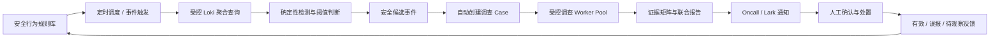

# AI 日志调查封版与安全行为检测闭环开发计划

> 日期：2026-10-17
> 当前基线：`303e992`、`92c5c12`、`9f1bf44`
> 适用范围：Dashboard「AI 运维 / 项目日志调查」、Grafana MCP、Loki、Oncall、Lark 通知
> 状态：现有人工调查链路建议封版；后续新增能力进入“安全行为特征与检测规则”独立阶段

## 1. 决策结论

当前“AI 项目日志调查”已经形成可用的只读调查闭环，可以进行功能封版：

- 用户可以从不完整线索开始调查；
- 后端通过受控计划访问 Grafana MCP / Loki；
- 调查支持绝对时间、相对时间、namespace、服务和自由线索；
- 高流量查询支持聚合计数、时间分片采样和截断说明；
- 多个调查任务可以形成深度调查 Case；
- Case 使用受控并发 worker pool 执行补查任务；
- 系统提取实体、请求、行为和结果信号，形成确定性证据矩阵；
- 联合报告区分事实、关联、业务结果和未确认事项，并引用证据 ID；
- AI 总结超时时使用精简事实集重试，最终失败也保留确定性证据；
- 页面展示任务阶段、进度、重试、失败和最终报告状态。

封版不表示停止维护。封版后允许：

1. 修复缺陷、安全问题和数据兼容问题；
2. 改善性能、状态可见性和可靠性，但不改变已有接口语义；
3. 补充测试、运维文档和迁移脚本；
4. 对真实案例进行回归验证。

封版后不继续把主动告警、自动防御、规则管理等能力堆叠到现有调查表单。它们应进入独立领域模型，同时复用现有调查、证据和报告能力。

## 2. 封版基线与真实场景验收

### 2.1 iCoin 真实安全场景

报告 `#6` 关联任务 `#16、#17、#18、#31～#36`，已验证：

- 环境：`icoin`；
- 调查任务：9 个；
- 日志证据：1,071 条；
- 查询：26 次，其中 10 次截断、6 次时间分片；
- 最大单项聚合测量：56,344 条；
- 服务：`ingress-nginx`、`kylin-user-center`、`kylin-gateway-app`；
- 能提取 IP、UID、Tenant、邮箱、手机号、域名、路径、状态码和会话标识；
- 能生成登录、身份认证、提现、OTC、2FA、安全设置、注销、回调和异常路径探测等分类统计；
- 能形成跨服务、跨任务和跨 Tenant 的候选关联；
- AI 联合报告生成成功，置信度为 `medium`，没有退化为超时兜底报告。

受控并发数为 2，真实执行顺序为三组并发：

```text
#31 + #32
#33 + #34
#35 + #36
```

### 2.2 当前能力能够回答的问题

- 哪些实体、服务、租户和路径被日志实际观察到；
- 某类请求或行为在指定时间范围内的聚合命中量；
- 哪些实体同时出现在多个任务、服务或租户；
- 哪些结论有直接证据，哪些只是调查导航关系；
- 哪些查询发生截断，哪些计数不能由逐行样本完整复核；
- 后续应补充哪些应用审计、业务结果或代理链证据。

### 2.3 当前能力不能宣称的结论

- 不能仅凭 IP 确认真实攻击者。CDN、代理和 NAT 会影响地址归属；
- 不能把 HTTP 2xx 等同于登录、提现、绑定或交易成功；
- 不能仅凭同一查询结果或同一 IP 认定多个账号由同一主体控制；
- 不能在缺少业务审计或状态变更记录时确认资金或账号损失；
- 不能让模型生成的推断自动触发封禁、回滚、账号冻结或数据修改。

这些限制属于证据边界，不是调查功能缺陷。

## 3. 封版门禁

封版以以下门禁为准：

| 类别 | 门禁 |
| --- | --- |
| 构建 | 前后端生产构建通过 |
| 测试 | 后端完整测试通过；并发、矩阵、采样和报告逻辑有自动化覆盖 |
| 数据库 | 调查任务、Case、报告和进度迁移均已纳入仓库 |
| 执行 | worker 并发由 SiteConf 控制，默认 2，范围 1～3 |
| 证据 | 报告事实必须引用 evidence ID；聚合测量标明来源 Job |
| 失败 | MCP、Loki 或模型失败不得伪装为零命中或成功结论 |
| 安全 | 模型不持有 Grafana Token，不直接执行任意 LogQL 或外部动作 |
| 真实验收 | iCoin 报告 #6 能形成结构化、带引用、声明边界的联合报告 |

生产部署还必须先执行：

```text
eks-dashboard-backend/scripts/sql/2026-10-17_aiops_log_investigation_job_progress.sql
```

## 4. 后续目标：安全行为特征与检测规则库

“特征库”方向可行，但不应只保存自然语言结论或 prompt。推荐建设版本化的 **安全行为特征与检测规则库**，把确定性检测、AI 调查和人工处置分层。

### 4.1 推荐闭环



原则：规则负责发现，调查 Agent 负责补证和解释，人负责高风险决策。

### 4.2 领域模型

#### DetectionRule

| 字段 | 说明 |
| --- | --- |
| `rule_key` / `version` | 稳定标识和不可变版本 |
| `name` / `description` | 用户可读名称和行为说明 |
| `environment_scope` | 适用环境；不能跨环境复用凭据 |
| `source_id` | 受控日志源 |
| `namespace` / `service_name` | 可选范围，不要求所有规则都固定 |
| `window_seconds` | 检测窗口 |
| `schedule_seconds` | 执行间隔 |
| `query_template` | 后端审核过的参数化模板，不允许任意 LogQL |
| `group_by` | Tenant、UID、会话、Host、弱 IP 等聚合维度 |
| `threshold_json` | 数量、速率、唯一值数量和组合阈值 |
| `severity` | info / warning / critical |
| `evidence_schema` | 必须保存的字段和证据引用规则 |
| `enabled` | 是否参与新检测 |
| `review_status` | draft / replay_passed / approved / disabled |

#### DetectionEvent

- 规则和版本；
- 环境、检测窗口和分组键；
- 实际测量值、阈值和严重级别；
- 查询摘要及哈希；
- 代表性证据 ID；
- 去重指纹；
- `OPEN / INVESTIGATING / CONFIRMED / FALSE_POSITIVE / RESOLVED`；
- 关联 Case、Oncall 告警和通知记录。

#### DetectionFeedback

- 操作者和时间；
- 有效、误报、部分有效或证据不足；
- 实际影响和处置结果；
- 对阈值、字段、窗口和规则版本的调整建议。

### 4.3 首批候选规则

1. 同一会话、设备或关联实体在短时间覆盖多个 Tenant；
2. 高频访问 `.env`、`actuator`、`admin`、`cms`、source map 等异常路径；
3. 登录、提现、OTC、2FA 等多个敏感行为在同一窗口集中出现；
4. 邮箱、手机号、设备标识或会话标识跨 Tenant 复用；
5. Google Authenticator 预绑定、验证码发送或校验异常重复；
6. 单一实体在多个 Host、服务和敏感路径间快速切换；
7. 应用审计明确记录鉴权拒绝、越权尝试或业务状态异常变更。

IP 只能作为弱特征。规则应保留 `peer`、`clientip`、`XFF`、CDN 节点和 workload 等角色，不允许用单 IP 直接确认主体或触发永久封禁。

## 5. 主动告警和防御策略

### 5.1 推荐分级

| 阶段 | 自动化范围 | 禁止事项 |
| --- | --- | --- |
| Observe | 保存检测事件、证据和趋势 | 不通知、不阻断 |
| Alert | 创建 Case，发送 Oncall/Lark 通知 | 不自动修改生产状态 |
| Assisted response | 人工确认后生成或执行临时限流/WAF方案 | 不允许模型绕过确认 |
| Bounded automation | 多特征、高置信、已回放验证的规则执行短期可恢复动作 | 不做永久封禁、资金或账号不可逆操作 |

首期只实现 `Observe + Alert`。防御动作必须独立建模，拥有权限、MFA、确认、有效期、回滚和审计，不复用普通调查接口。

### 5.2 通知内容

通知只包含：规则、环境、严重级别、时间窗口、聚合测量、主要实体、证据边界和 Dashboard Case 链接。不得把大段原始日志、Token、验证码或预绑定秘密发送到群聊。

## 6. 分阶段开发计划

### Phase 0：封版与基线固定

- 冻结现有调查接口语义和证据矩阵结构；
- 为 iCoin 报告 #6 保存脱敏回归 fixture / 金标断言；
- 记录查询、Case 和报告的耗时、超时、截断率和失败率；
- 完成生产迁移和部署验证。

验收：相同 fixture 可稳定提取核心实体、行为类别、证据边界，并且不会把 IP 或 HTTP 2xx 错判为最终业务结果。

### Phase 1：规则登记与离线回放

- 新增规则、版本和审核状态；
- 管理员可以创建、复制、停用规则；
- 使用历史时间窗执行只读回放；
- 展示命中量、样本、预计告警频率和可能误报；
- 只有 `replay_passed + approved` 规则才能进入定时检测。

验收：规则发布前可以知道历史命中情况，不触发通知或生产动作。

### Phase 2：定时检测与候选事件

- 使用数据库队列和租约执行调度；
- 按环境设置并发、速率和查询预算；
- 生成具有幂等指纹的 DetectionEvent；
- 零命中、数据源失败、查询截断必须区分；
- 首期默认 Observe 模式。

验收：重复窗口不产生重复事件；Grafana/MCP 故障不会被记录为安全正常。

### Phase 3：Case 与通知闭环

- 高于阈值的事件自动创建深度调查 Case；
- Case 复用现有 worker pool、证据矩阵和联合报告；
- 终态报告发送 Oncall/Lark 摘要；
- 人工标记有效、误报、证据不足和处置结果。

验收：从规则命中到通知、调查、反馈均可追踪，不需要人工复制日志或任务 ID。

### Phase 4：辅助防御

- 独立的 ResponsePolicy 和 ResponseExecution；
- 支持有时效、可回滚的限流或 WAF 建议；
- 权限、MFA、人工确认和审计；
- 依据历史反馈评估自动化门槛。

验收：任何生产变更都有明确操作者、目标、有效期、回滚结果和审计记录。

## 7. 质量指标

- 规则命中到候选事件生成延迟；
- 候选事件到 Case 报告完成时间；
- MCP/Loki/模型失败率和重试成功率；
- 查询截断率、时间分片覆盖率；
- 有证据引用的结论比例；
- 人工确认率、误报率和证据不足率；
- 每条规则每日告警量和重复抑制率；
- 防御动作回滚成功率（Phase 4 后）。

不得把模型置信度单独作为自动防御门槛。

## 8. 与现有文档关系

- [AI 日志调查开发计划](./2026-10-11-aiops-project-log-investigation-development-plan.md)：日志源、凭据、MCP 和有界调查基础设计；
- [AI 运维统一调查工作台计划](./2026-10-13-aiops-unified-investigation-workbench-development-plan.md)：告警调查、证据时间线、质量和通知边界；
- 本文：当前人工调查能力的封版基线，以及安全行为规则、主动检测、通知和防御的后续路线。

后续开发以本文 Phase 为增量，不重复改造已经封版的日志调查核心链路。
