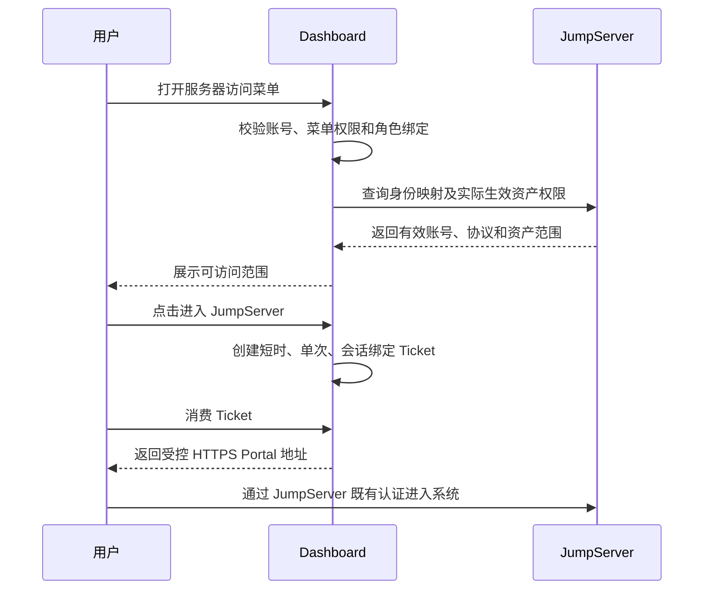

# Dashboard JumpServer 集成开发计划

更新时间：2026-10-18  
分析基线：`/Users/liuzelin/github/dashboard` 当前 `main`、`/Users/liuzelin/github/somas` 当前 `ops-tools` 及指定历史提交  
文档性质：开发设计与分阶段验收计划；第一版不开放普通用户自助申请

## 1. 结论

JumpServer 可以作为独立 Provider 接入 Dashboard 运维系统。第一版采用：

> **运维系统自定义角色 → JumpServer 授权包 → JumpServer 实际权限核验 → 单次受控跳转**

角色不是系统预置的“Dashboard 角色”。Admin 可以在运维系统中创建任意自定义角色，再把角色绑定到一个或多个 JumpServer 授权包，并把角色分配给用户。

第一版不建设普通用户申请、审批和按小时授权。用户持有有效角色且远端授权同步成功期间，可以进入 JumpServer；角色移除、用户禁用、授权包解绑或远端权限回收后，应立即失去访问资格。

短时 Ticket 只保护一次跳转，不等于限时资产授权：

- Ticket 建议有效 60–120 秒、只能消费一次，并绑定当前用户和登录会话；
- Ticket 消费后失效，不决定 JumpServer 会话时长；
- 第一版资产授权生命周期跟随运维系统角色；
- 后续申请链路才引入真正的 Grant 有效期、到期回收和审批。

## 2. 设计来源与取舍

### 2.1 Somas 历史提交提供的设计证据

| Commit | 可复用经验 | 本项目取舍 |
| --- | --- | --- |
| `9814a06` | 集成边界和分阶段交付 | 复用阶段门禁，不复制 Somas 系统边界 |
| `8288c4d` | HTTP Signature、只读健康和资产目录 | 复用 Connector 契约与 GET allowlist |
| `935986c` | 身份映射和一次性 Portal Ticket | 复用安全语义，改用 Dashboard 用户稳定 ID |
| `53e7884` | Grant 创建、撤销和回收 | 第一版只用于角色授权同步；自助申请暂缓 |
| `3213784` | 会话、命令审计元数据 | 后续阶段只回流摘要和稳定引用 |
| `00173bf` | 跳转前必须存在有效 Grant | 作为第一版强制校验 |
| `827c4dc` | 查询用户实际生效资产权限 | 作为第一版强制校验，不能只信本地记录 |
| `505df6d` | 预检、熔断和生产安全控制 | 复用 feature flag、只读预检和回滚门禁 |

### 2.2 明确不迁移的内容

- 不依赖 Somas API、数据库、用户、角色、项目成员或在线状态；
- 不迁移 Somas Passkey、Lark 身份映射和历史运行数据；
- 不直接复制 Somas 的 FastAPI/Vue 页面、表结构和审批状态机；
- 不把现有 Dashboard“Windows 跳板机”菜单改名后复用；两者职责不同；
- 不在 Dashboard 保存 JumpServer 用户密码、私钥、Cookie、录像或命令原文。

## 3. 第一版用户体验

新增独立菜单“服务器访问（JumpServer）”。

### 3.1 Admin 配置流程

1. 配置 JumpServer Provider 和专用机器身份；
2. 同步或实时读取用户组、资产节点、资产、账号和协议目录；
3. 创建“授权包”，选择受控的用户组、资产节点/资产、账号和协议；
4. 把授权包绑定到一个或多个运维系统自定义角色；
5. 把角色分配给用户；
6. 后端把角色期望状态同步到 JumpServer，并展示同步结果和漂移状态。

### 3.2 普通用户使用流程



### 3.3 失败提示

必须区分并向用户展示：

- 没有菜单/动作权限；
- 尚未建立 JumpServer 身份映射；
- 角色没有绑定授权包；
- 远端授权正在同步；
- 本地期望授权与 JumpServer 实际权限不一致；
- Provider 不可用或权限不足；
- Ticket 过期、已使用或不属于当前会话。

禁止在远端权限尚未生效时提供“直接跳转”作为降级路径。

## 4. 权限与授权模型

### 4.1 运维系统权限键

建议新增：

| 权限键 | 用途 |
| --- | --- |
| `menu:jumpserver` | 查看服务器访问菜单 |
| `jumpserver:portal:launch` | 查询本人有效范围并发起受控跳转 |
| `jumpserver:config:manage` | 管理 Provider、身份映射、授权包和角色绑定 |
| `jumpserver:sync:execute` | 执行授权同步、撤销和人工对账 |
| `jumpserver:audit:read` | 查看跳转、同步和会话摘要 |

前端菜单和按钮隐藏不构成授权。所有后端接口必须再次校验动作权限、用户状态、角色绑定、Provider 绑定和目标范围。

### 4.2 授权包模型

```text
JumpServerAccessBundle
  id, name, description, enabled
  providerId
  remoteUserGroupRefs[]
  remoteNodeRefs[] / remoteAssetRefs[]
  accountSelectors[]
  protocols[]
  riskLevel

JumpServerRoleBinding
  roleId
  bundleId
  enabled
  createdBy, createdAt, updatedAt
```

授权包只允许从远端目录选择稳定 ID，禁止自由填写资产、节点、用户组或 URL。角色名称由 Admin 自定义，业务逻辑不能按角色名称硬编码。

### 4.3 身份映射

```text
JumpServerIdentityMapping
  dashboardUserId
  providerId
  jumpserverUserId
  jumpserverUsername
  expectedEmail
  status
  verifiedAt
```

优先使用双方稳定 subject/用户 ID；邮箱只能作为经核验的匹配候选，不得仅凭同名自动授权。冲突、重复、远端禁用和邮箱变化必须阻断同步。

### 4.4 权限事实源

- 运维系统角色及其授权包绑定是**期望状态**；
- JumpServer 用户、用户组、Asset Permission 和 effective asset access 是**执行状态**；
- 用户能否跳转必须同时满足本地期望状态和远端实际有效状态；
- 定时对账发现漂移时，默认阻断跳转并告警，不能把本地 `SYNCED` 当作永久事实。

## 5. Provider 和凭据边界

正式运行不得使用 JumpServer `admin` 用户密码或人工管理员 Access Key。建议至少拆分：

| 机器身份 | 权限边界 |
| --- | --- |
| `dashboard-jumpserver-reader` | 健康、用户、用户组、节点、资产、授权和 effective access 只读 |
| `dashboard-jumpserver-grant-manager` | 仅管理 Dashboard 命名空间内的用户组成员关系和 Asset Permission；不管理系统配置、组织或其他授权 |
| `dashboard-jumpserver-auditor`（后续） | 会话及命令元数据只读，不读取录像和敏感正文 |

Access Key 使用 JumpServer HTTP Signature。Secret 只保存在受控 Secret/SiteConf 敏感值中，不返回前端、不进入日志、审计 JSON、异常文本或 Git。若 JumpServer 支持来源 IP 限制，应只允许 Dashboard 后端固定出口。

Admin 账号启用 MFA 是正确边界；账号密码只供人工管理，不作为 Dashboard 自动化登录方案。

## 6. 后端模块建议

```text
jumpserver/
  jumpserver.controller.ts
  jumpserver.service.ts
  jumpserver-provider.service.ts
  jumpserver-policy.service.ts
  jumpserver-reconciliation.service.ts
  jumpserver-ticket.service.ts
  dto/
```

Provider 必须采用显式 endpoint allowlist，不建设任意 URL/Method/Body 的通用代理。HTTP 客户端需要：

- HTTPS 校验、固定 base URL、SSRF/DNS rebinding 防护；
- HTTP Signature 规范化签名；
- 超时、有限重试、分页上限和响应大小上限；
- 401/403/404/409/429/5xx 分类；
- 敏感字段和远端异常文本脱敏；
- 写操作幂等键、期望状态 hash 和 Provider receipt。

## 7. 数据与审计

建议表：

- `jumpserver_providers`
- `jumpserver_identity_mappings`
- `jumpserver_access_bundles`
- `jumpserver_bundle_targets`
- `jumpserver_role_bindings`
- `jumpserver_sync_runs`
- `jumpserver_sync_events`
- `jumpserver_portal_tickets`
- `jumpserver_portal_events`
- `jumpserver_session_refs`（后续）

审计保存：操作者、目标用户、角色 ID、授权包 ID、远端稳定 ID、期望状态 hash、动作、结果、时间和脱敏错误摘要。不得保存 Access Key、密码、Cookie、录像 URL 中的临时签名、完整命令和文件内容。

## 8. 分阶段实施计划

### Phase 0：运行态与 API 契约核验

只读完成：

- URL、TLS、版本、健康、认证方式和 HTTP Signature；
- 当前 Access Key 的主体、角色和可见组织范围；
- 用户、用户组、节点、资产、账号、协议、Asset Permission 和 effective access API；
- Portal/SSO 入口、认证跳转行为及能否形成用户绑定深链；
- 分页、限流、错误结构和时区；
- Dashboard EC2 到 JumpServer 的网络连通性。

输出能力矩阵，敏感值全部脱敏。只读核验通过不代表当前 admin Access Key 可以进入正式配置。

### Phase 1：只读目录和配置管理

- 新增 Provider、权限键、菜单和健康诊断；
- 管理身份映射、授权包和角色绑定；
- 读取用户组、节点、资产、账号、协议和现有授权；
- 提供预览：某角色/用户预期获得哪些范围；
- 不执行远端写操作。

验收：跨 Provider/跨范围输入被拒绝；用户不能自由输入远端 ID；Secret 不泄露；目录分页和错误分类测试通过。

### Phase 2：角色驱动授权同步

- 使用专用 Grant Manager 创建或维护受管用户组及 Asset Permission；
- 用户新增/删除角色、账号禁用、授权包变更触发幂等同步；
- Worker 定时对账并修复或标记漂移；
- 所有删除先验证资源由 Dashboard 创建或纳入受管范围；
- 写操作支持 dry-run、影响预览、确认和审计。

验收：赋权、撤权、重复同步、部分失败、远端手工变更、Provider 超时和结果未知均有自动化测试；真实测试仅使用隔离用户和非生产资产。

### Phase 3：受控 Portal 跳转

- 跳转前实时或短缓存核验 effective asset access；
- 创建 60–120 秒、单次、绑定用户及当前登录会话的 Ticket；
- Ticket 数据库只保存 hash，消费使用行锁/CAS 防重放；
- 返回固定 HTTPS Portal，不接收前端自定义 redirect URL；
- 记录 prepared、consumed、denied 和 expired 事件。

验收：无映射、无角色、远端未生效、过期、重复消费、跨用户和跨会话全部拒绝。

### Phase 4：生产化与运行保障

- 为读身份和写身份创建最小权限机器账号并轮换临时 admin Key；
- 增加 feature flag、熔断、队列重试、失败告警和人工对账；
- 从 Dashboard EC2 验证 TLS、网络和真实只读/受控写链路；
- 编写停用、凭据轮换、漂移修复和紧急回收 Runbook；
- 灰度开放一个非生产授权包后再扩展。

## 9. 后续增强与扩展方向

### 9.1 普通用户申请和限时授权

后续复用统一运维申请模型：用户申请资产、账号、协议、时长和理由；审批通过后生成真正有有效期的 JumpServer Grant，到期自动回收。跳转 Ticket 仍只是一次跳转凭证，两者生命周期独立。

### 9.2 审批和强认证

- 高风险资产双人审批、禁止自批；
- 审批和人工强制回收使用服务端 MFA/WebAuthn；
- 审批绑定请求快照 hash，范围变化后重新审批；
- break-glass 单独建模、短时有效并强告警。

### 9.3 会话审计回流

- 增量读取会话、命令和文件传输元数据；
- Dashboard 保存会话 ID、用户、资产、开始/结束、状态及远端引用；
- 录像、命令原文和文件内容保留在 JumpServer；
- 支持审计延迟、缺口和同步失败告警。

### 9.4 多 JumpServer 与环境治理

- 支持多个 Provider 实例及独立凭据；
- 授权包显式绑定 Provider，不依赖左上角环境选择器隐式路由；
- 列表展示所属环境/Provider，禁止跨 Provider 拼接资源；
- 支持按组织、项目、环境或业务域分组，但不硬编码现有环境 ID。

### 9.5 自动回收和生命周期事件

- 用户禁用、离职、角色移除和授权包停用触发回收；
- 定期检测孤儿用户、孤儿授权和超范围权限；
- 回收失败进入重试队列并告警，最终状态不能伪标成功；
- 提供授权影响分析和批量迁移预览。

## 10. 自动化测试策略

| 层级 | 重点 |
| --- | --- |
| 单元测试 | 权限依赖、角色聚合、授权包展开、Ticket 过期/防重放、脱敏 |
| Connector 契约测试 | HTTP Signature、分页、限流、超时、错误分类和 endpoint allowlist |
| Service 测试 | 身份冲突、期望状态 hash、幂等同步、撤销、漂移和 UNKNOWN 对账 |
| 前端测试 | 自定义角色选择、范围预览、阻断原因和危险确认 |
| 集成测试 | 隔离用户、用户组、非生产资产的赋权/撤权/effective access |
| E2E | Admin 配置角色 → 用户跳转 → 角色撤销 → 跳转被拒绝 |

自动化测试默认 Mock Provider，不能创建真实生产授权。真实链路只在专用测试范围人工触发，并在结束后验证无遗留权限。

## 11. 上线门禁

必须全部满足：

1. 专用 Reader 与 Grant Manager 已创建，admin 凭据未进入运行配置；
2. 用户、角色、授权包和远端实际权限的关系可以对账；
3. 角色撤销和用户禁用能够真实回收权限；
4. 跳转前核验 effective access，直接访问 URL 不能绕过 JumpServer 自身授权；
5. Ticket 防重放、跨用户和跨会话测试通过；
6. Provider 不可用时失败关闭；
7. Secret、密码、Cookie、录像和命令原文未进入前端、日志或审计；
8. 具备 feature flag、回滚和紧急回收 Runbook。

## 12. 当前边界说明

本计划描述的是 Dashboard 独立实现。Somas 代码和历史提交仅用于设计参考；Somas 不参与运行时鉴权、授权同步、Portal 跳转或审计查询。当前本地凭据只允许用于 Phase 0 只读核验，不视为正式机器身份。

## 13. Phase 0 只读运行态快照（2026-10-18）

使用本地受控文件中的 Access Key，以 HTTP Signature 对目标 JumpServer 做了 GET-only 核验；未使用 admin 密码登录，未创建、修改或删除任何远端资源，未输出凭据、用户详情、资产地址、账号内容、命令或会话正文。

### 13.1 已确认

- 目标为 `https://jms.pree.mg56.net`，Portal 根路径返回 `200`；
- `/api/health/` 匿名和签名请求均返回 `200` 且健康状态为 true；
- TLS 证书 CN/SAN 与目标域名一致，Amazon CA 签发，有效期为 2026-10-16 至 2027-05-01；
- 当前为 Community Edition，公开设置返回 `XPACK_ENABLED=false`；
- Access Key 的 `/api/v1/users/profile/` 请求成功；其主体是启用状态的人工 `admin`，具有 `System Admin`，不是 service account；
- 当前组织接口可读取；
- 用户、用户组、节点、资产、平台、账号、Asset Permission、会话和命令列表接口均返回 `200`；
- 本次可见目录规模为：用户 35、用户组 10、节点 16、资产 83、平台 25、账号 81、Asset Permission 15、会话 2685；命令列表当前为 0；
- `/api/v1/perms/users/{userId}/assets/{assetId}/` effective-access 接口返回 `200`，响应包含 `permed_protocols` 与 `permed_accounts`，能够支持跳转前的远端实际权限核验。

这些数量只是 2026-10-18 的只读快照，会随运行态变化，不能作为代码常量或上线后的固定验收值。

### 13.2 风险与结论

当前 Access Key 绑定人工 admin，并具有 System Admin 及广泛目录/审计可见性。它证明了目标系统、HTTP Signature 和关键只读 API 可用，但权限明显大于正式 Dashboard Connector 所需范围。因此：

1. 不得把当前 admin 的密码、ID 或 Secret 写入仓库、SQL migration、前端或正式 SiteConf；
2. 不使用 admin 密码绕过 MFA，MFA 登录保护保持不变；
3. 正式开发前在 JumpServer 中创建专用 Reader 和 Grant Manager 机器身份，并重新执行正向读取与越权拒绝测试；
4. 写 API、用户组成员维护、Asset Permission 创建/撤销、Portal/SSO 深链尚未执行真实契约测试；进入 Phase 2/3 前必须在隔离用户和非生产资产范围人工验收；
5. 本次探测接口未直接暴露明确版本号，后续应通过受控管理页面或官方支持接口记录准确版本，不能根据页面资源或响应结构猜测。

### 13.3 Phase 0 当前状态

| 检查项 | 状态 |
| --- | --- |
| HTTPS、TLS、健康 | 已通过 |
| HTTP Signature | 已通过 |
| 当前主体与权限级别 | 已确认，权限过宽 |
| 用户/组/节点/资产/账号目录 | 已通过 |
| Asset Permission 目录 | 已通过 |
| effective asset access | 已通过 |
| 会话/命令元数据读取 | 已通过 |
| 精确版本 | 待确认 |
| 专用最小权限 Reader | 待创建与验证 |
| 专用 Grant Manager | 待创建与验证 |
| 用户组/Asset Permission 写契约 | 待隔离验证 |
| Portal/SSO 用户绑定跳转 | 待验证 |
| Dashboard EC2 网络链路 | 待部署前验证 |

## 14. Phase 1–3 实施记录（2026-10-18）

### 14.1 已实现

- Dashboard 新增独立“服务器访问（JumpServer）”菜单和五个权限键；
- 新增 Provider、身份映射、授权包、角色绑定、同步状态、Portal Ticket 和事件表；
- 授权包绑定运维系统自定义角色，不按角色名称硬编码；
- Reader/Grant Manager 使用独立 HTTP Signature 凭据；
- 后端对 GET/写 endpoint 使用显式 allowlist；Reader 不能执行写操作；
- 授权同步只创建 `dashboard:bundle:*` 命名的 Asset Permission；撤销前再次读取并验证受管前缀；
- 用户失去角色或授权包后，同步流程回收对应受管 Permission；
- 跳转前读取远端 Permission 状态，远端失效或漂移时阻断；
- Ticket 有效期 60–300 秒、默认 120 秒，数据库只保存 hash，并绑定用户和浏览器会话标识；
- 前端提供本人状态、Provider 诊断、身份映射、授权包/自定义角色绑定、人工同步和受控跳转入口。

### 14.2 机器身份

已创建两个 Dashboard 专用 Service Account：

- Reader：内置 `System Auditor`；可读取资产目录，读取 Asset Permission 返回 403；
- Grant Manager：内置 `System Admin`；可管理 Asset Permission。

Access Key 保存在本地权限为 `0600` 的受控文件并已同步到本地开发数据库的敏感 SiteConf。引导用临时密码文件已永久删除。当前 Community Edition 不支持满足本场景的精细自定义角色，所以 Grant Manager 暂时仍有较宽远端权限；Dashboard 通过独立身份、endpoint allowlist、受管命名前缀和目标目录约束降低风险。生产启用前仍应评估升级许可或增加 JumpServer 侧更细粒度角色的可能性。

### 14.3 真实契约验证

使用独立临时测试用户和明确的非生产测试资产完成：

1. 创建测试用户；
2. 创建仅包含该用户、单一测试资产、`ssh` 和 `connect` 的临时 Asset Permission；
3. effective-access API 返回允许的 SSH 协议和一个远端账号；
4. 删除临时 Permission；
5. 删除临时用户。

测试资源已清理，无测试授权遗留。自动化测试不会重复触发真实远端写操作。

### 14.4 Phase 3 边界

当前 Ticket 是 Dashboard 内部的一次性入口门禁和审计凭证：消费成功后返回固定 JumpServer HTTPS Portal，用户继续经过 JumpServer 既有登录、MFA 或 SSO。Ticket 不会创建 JumpServer Cookie，也不是 JumpServer 原生免登录 Token。用户直接知道 Portal URL 时仍会面对 JumpServer 自身认证与实际资产授权，不能仅凭 URL 访问资产。

若未来要求“从 Dashboard 单击后自动建立 JumpServer 用户会话”，必须先确认目标版本官方支持的 SSO/一次性登录票据协议，再新增双方信任；不得由 Dashboard 模拟填写账号密码或代持 Cookie。

### 14.5 尚未完成的部署验收

- 将 migration 和敏感 SiteConf 部署到 Dashboard EC2；
- 从 EC2 应用进程验证 Reader/Grant Manager 网络与 TLS；
- Admin 在页面建立一个真实用户映射、授权包和自定义角色绑定；
- 普通用户完成“角色授权 → 同步 → 页面可进入 → 角色撤销 → 页面被阻断”的完整人工验收；
- 根据验收结果决定是否启用自动周期对账 Worker。当前版本提供幂等人工同步和跳转前漂移核验，尚未启用后台自动写入。
