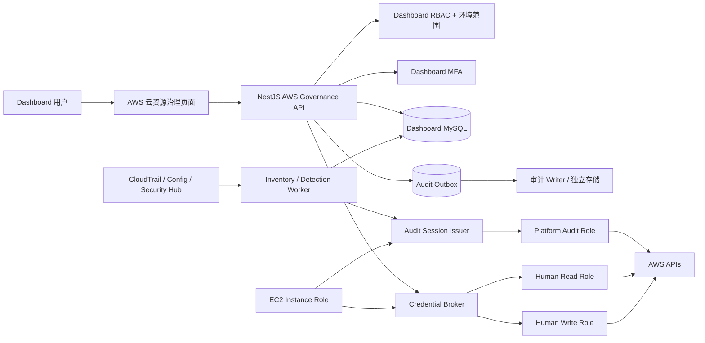
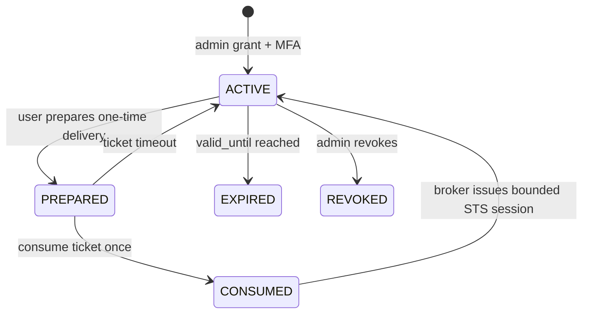

# Dashboard AWS 云原生资源治理与临时访问开发计划

更新时间：2026-10-20

分析基线：`/Users/liuzelin/github/somas` 所列 13 个历史提交、`/Users/liuzelin/github/dashboard` 当前工作区

文档性质：代码级可行性分析与实施计划；本次未修改业务代码、数据库、AWS 或线上配置

## 1. 结论

该能力适合迁入 Dashboard，但不适合直接复制 Somas 的代码、数据表或页面。

推荐采用 **“Dashboard 作为 AWS 运维控制面，AWS 作为执行与审计事实源”** 的方案：

1. 复用 Somas 已验证过的安全原则和领域模型：身份分离、短时授权、授权快照、只读快照、Finding、治理工作流、项目隔离和独立审计。
2. 使用 Dashboard 现有 NestJS/React、用户与角色权限、环境选择器、MFA、审计日志、资产管理和 `EC2 Instance Role -> Environment Target Role` 链路重新实现。
3. 把能力拆成两个边界清晰的域：
   - **AWS 资源治理**：平台只读采集、资源目录、快照差异、规则检测、Finding 与整改闭环。
   - **AWS 临时访问**：首版由管理员直接给 Dashboard 用户授予受控读写权限，绑定有效期，到期后自动停止使用并异步回收；用户自助申请和多级审批后续再做。
4. 首版先完成只读资源治理，不把“资源列表”直接做成通用 AWS 控制台，也不开放任意 SDK API、任意 IAM Policy 或长期 AK/SK。
5. 首版仅接入 `hashex` 环境的一个 AWS 账号；表结构、Provider 接口和页面字段保留 `environment_id/cloud_account_id`，但不同时建设其他环境和账号。
6. 临时访问仍通过 Credential Broker 隔离动态凭据。凭据不得进入浏览器、MySQL、日志、SiteConf 或普通 API 响应；来源出口 IP 限制降为后续增强。
7. Somas 保持为参考实现；不让 Dashboard 在运行时依赖 Somas API、数据库、用户、项目或 Passkey。

这不是简单的“迁移页面”，而是把 Somas 中可复用的控制原则映射到 Dashboard 已有架构中。

## 2. 检查范围与事实边界

### 2.1 已检查

- Somas 所列提交的提交说明、变更范围及当前代码中的对应实现。
- Somas AWS 临时访问、Credential Broker、审批、来源 IP、资源采集、安全审计、Feature Center、项目隔离、独立审计存储和身份拆分文档。
- Dashboard 当前环境配置、AWS Client 创建、Instance Role/Target Role、资产管理、安全组、ACM、KMS、S3、审计、RBAC、MFA、菜单和 Provider 模块。
- Dashboard 已有 Somas 运维能力拆分计划，避免重复建设 JumpServer、Bytebase、CI/CD 等已落地能力。

### 2.2 未检查或未证明

- 未连接线上 AWS、Somas、Dashboard、MySQL 或 EC2。
- 未验证各环境目标 Role 的真实策略、信任策略、External ID、Session Tag 和 CloudTrail 配置。
- 未验证 Somas 当前生产部署版本是否包含这些历史提交。
- 未统计各 AWS 账号资源量、API 节流预算、CloudTrail 数据量和现有 Security Hub/Config/Organizations 覆盖情况。

因此，本计划中的运行态结论需要在 Phase 0 重新读取真实配置后才能确认。

## 3. 为什么不能直接复用 Somas 代码

| 维度 | Somas | Dashboard | 迁移判断 |
| --- | --- | --- | --- |
| 后端 | FastAPI/Python | NestJS/TypeScript | 不能复制 Service/Router，只能复用契约和状态机 |
| 前端 | Vue 3 | React 19 + Ant Design | 不能复制页面，需复用 Dashboard `ops` 组件 |
| 用户与授权 | Somas 用户、项目成员、Passkey | Dashboard 用户、动态角色权限、环境、TOTP MFA | 以 Dashboard 为唯一授权源 |
| AWS 项目模型 | `security_audit_projects` | `environments_config` + 资产账号 | 需建立显式云账号绑定，不复制项目表 |
| AWS 身份 | Audit Issuer、Credential Broker、人读/人写 Role | EC2 Instance Role -> 每环境 `aws_role_arn` | 保留身份分离，重构统一凭据工厂 |
| 审计 | Outbox + 独立 Audit Store | `audit_logs`，写失败仅告警 | 高风险域不能只依赖现有 best-effort 审计 |
| 数据采集 | Python Collector/Feature Worker | 当前多为请求时实时读取 | 需新增 Worker、快照和对账模型 |
| 工作流 | Somas Workflow/Task | Dashboard 各 Provider 自有状态 | 先做 AWS 域状态机，后续再抽通用工作流 |

直接复制会导致两套用户、项目、审批、AWS 身份、审计和资产事实源并存，维护成本和越权风险均高于重写适配层。

## 4. 所列提交的复用决策

| Somas 提交 | 可复用内容 | Dashboard 落点 | 不直接迁移内容 |
| --- | --- | --- | --- |
| `6370e1b` 临时权限业务模型 | 有效期、用途、访问级别和生命周期 | 管理员创建 `aws_access_grants`，用户使用被授予的权限 | 用户自助申请、Somas 用户、Lark、Chat、Passkey 页面 |
| `c70f0c8` Credential Broker | 凭据隔离、私有签发面、请求绑定 | 独立 Broker Lambda/私网服务；Dashboard 只拿交付回执 | 在 NestJS 内直接返回 STS 凭据 |
| `8c36d54` 审批完整性 | 授权快照 hash、不可变绑定 | `grant_hash`、幂等键与一次性 ticket | 首版审批签名；Somas 签名服务和密钥布局 |
| `b625652` 出口 IP 绑定 | 可作为后续增强的附加限制 | 首版不实现；后续在有稳定受控出口时再接入 | 让用户任意输入公网 IP |
| `b1edbe6` AWS 数据快照 | 增量采集、快照、diff、采集回执 | Inventory Run/Snapshot/Resource/Change | 请求时把完整 AWS JSON 返回页面 |
| `fd3ec6e` 安全审计 | 调度、Finding、报告、导出 | Detection Run/Finding/Evidence/Export | Somas 安全审计页面和 AI 配置 |
| `f7393e3` 治理工作流 | Finding 评审、豁免、整改、审批 | Finding 状态机和 Remediation Task | 直接复制大型 Feature Center Service |
| `ec5a33c` 数据处理与行为检测 | Source、Checkpoint、幂等批次、规则检测 | Phase 4 行为检测 Provider | 首版采集 CloudTrail 全量与复杂基线 |
| `0dfce93` 项目数据隔离 | 服务端行级范围校验、越权测试 | `environment_id/cloud_account_id` 强制过滤 | 只依赖左上角选择器或前端隐藏 |
| `43adba0` 独立审计存储 | Outbox、异步 Writer、完整性 hash | 高风险 AWS 审计 Outbox；后续独立存储 | Phase 1 就部署第二数据库 |
| `e2fb5b5` 当前 AWS 身份架构 | 平台审计、人读、人写身份分离 | 三类 Target Role；精确 AssumeRole allowlist | 一个宽权限 Role 覆盖采集和人工写入 |
| `4cda443` 数据看板与生产保障 | Worker 心跳、运行指标、灰度、规则版本 | Provider 健康、任务运行中心、规则版本 | 一次性迁移全部运营看板 |
| `07d17f0` 动态凭据和数据库基线 | 移除静态凭据、迁移清单、基线一致性 | 禁止 AK/SK；幂等 SQL + schema read-back | 把敏感值写入 SiteConf |

## 5. 目标范围

### 5.1 第一版核心范围

- 仅运行 `hashex` 环境的目标 AWS 账号，支持该账号的区域级资源目录。
- 数据模型、权限校验和 Provider 契约显式携带 `environment_id/cloud_account_id`，为后续多环境、多账号接入占位。
- 只读 Inventory 同步：至少 EC2、EBS、ELB/ALB/NLB、EKS、RDS、S3、Route 53、ACM、Security Group、IAM Role 摘要。
- 资源快照与两次快照差异。
- Provider 健康、最后成功时间、部分失败、节流和权限缺失提示。
- 声明式规则检测与 Finding 生命周期。
- Dashboard RBAC、环境/账号范围、审计和导出。
- 不修改 AWS 资源。

### 5.2 第一版临时授权范围

- 仅管理员在 Dashboard 内选择用户、`hashex` AWS 账号、受控权限类型、区域和到期时间后创建授权。
- 创建、修改、提前回收授权时校验管理员 MFA，并记录管理员、目标用户、权限范围、有效期和原因。
- 普通用户不能自助申请、续期或扩大权限；只能查看和使用自己的有效授权。
- 支持管理员预设的权限类型，例如 `READ_ONLY`、`LIMITED_WRITE` 以及后续增加的受控模板；用户不能提交任意 IAM Policy。
- 使用短时会话、一次性 ticket、到期停用和自动回收语义。
- CloudTrail 事件与 grant/session 的关联。

### 5.3 后续增强

- CloudTrail/Config/Security Hub/GuardDuty 的行为和安全信号统一接入。
- 普通用户自助申请、多级审批、禁止自批和续期工作流。
- 多环境、多 AWS 账号的真实配置和灰度接入。
- 稳定受控出口具备后，增加来源出口 IP/CIDR 限制。
- 整改任务、豁免、维护窗口、SLA 和通知。
- 受控自动修复；必须按具体动作实现，禁止通用 AWS API 代理。
- 独立不可变审计存储、跨账号 Organizations 汇总、成本与配额治理。

### 5.4 明确不做

- 不做 AWS Console 的页面级克隆。
- 不允许用户提交任意 IAM Policy JSON、任意 AWS API 名称或任意 CLI 命令。
- 不保存或展示长期 AK/SK、STS SecretAccessKey、SessionToken。
- 不复用 Somas 运行数据库，不依赖 Somas 在线服务。
- 不在首版合并平台采集 Role 与人工访问 Role。
- 不在首版实现普通用户申请、审批队列、双人审批或来源 IP 限制。
- 不在首版同时接入 hashex 以外的环境或 AWS 账号。
- 不把采集失败等同于“资源不存在”。

## 6. 目标架构



### 6.1 身份边界

建议每个 AWS 账号至少拆分以下身份：

1. `DashboardPlatformAuditRole`：无人值守只读采集，仅信任 Audit Session Issuer。
2. `DashboardHumanReadRole`：人工临时只读，仅信任 Credential Broker。
3. `DashboardHumanWriteRole`：人工受限写入，仅信任 Credential Broker，权限按动作收敛。

Dashboard EC2 Instance Role 只获得调用 Issuer/Broker、读取必要 secret 引用、写审计的权限，不直接获得所有目标账号业务权限。

首版若暂不部署 Issuer，可由现有 Instance Role 精确 Assume `DashboardPlatformAuditRole`，但必须保留独立字段和迁移路径，不能继续复用功能型 `aws_role_arn` 作为永久总入口。

### 6.2 凭据交付边界

临时访问不应让浏览器直接接收明文 STS 凭据。推荐优先级：

1. 本地 Agent 使用一次性 ticket + 客户端公钥领取加密凭据包。
2. 受控 Web Terminal/Runner 在隔离执行环境中使用凭据。
3. AWS Console federation URL 由后端生成短时跳转，但不在日志或数据库保存完整 URL。

不推荐在页面显示可复制的 AK/SK/SessionToken。

第一版只需实现其中一种交付方式并跑通 `hashex`，不同时建设 Agent、Runner 和 Console federation。若现有条件无法安全交付临时会话，则先完成授权、到期回收和审计，不以明文凭据作为临时替代方案。

## 7. 与 Dashboard 现有实现的整合

### 7.1 可直接复用

- `AccessControlService` 的动态角色和 permission key。
- `EnvironmentContext` 和可搜索环境选择器。
- `MfaVerificationService` 的敏感动作验证。
- `AuditService` 的脱敏规则和审计查询页面。
- `EnvironmentsService` 的 Instance Metadata + `fromTemporaryCredentials` 基础链路。
- 资产管理中的账号、资源、环境归属和 Provider 设计。
- `components/ops` 中 PageHeader、MetricGrid、FilterBar、OpsTable、DetailDrawer、StatusBadge、RiskConfirm。
- 现有依赖健康、CI/CD、Bytebase、JumpServer Worker 的锁、重试、对账和静默刷新经验。

### 7.2 必须改造

1. `EnvironmentsService.getAwsClients()` 当前按环境缓存一组客户端，且主要使用单一 `aws_role_arn`。AWS 治理需改为按 `identityPurpose + account + region` 创建短时客户端，缓存 Provider 而不是缓存凭据。
2. `environments_config` 仍保留旧 AK/SK/Profile 字段。新模块不得读取这些字段；后续单独做废弃迁移，不与本项目首版绑死。
3. `audit_logs` 是 best-effort 写入，写失败不会阻断业务。只读采集可继续写普通审计；管理员授权、修改、签发、消费、提前回收和到期必须先落 Outbox/领域事件，再执行敏感动作。
4. 左上角环境选择器不能作为数据隔离边界。所有查询、详情、导出、同步和操作均需在服务端验证用户的环境/云账号范围。
5. 资产模块存在第三方 AK/SK 类型凭据引用。AWS 新模块只能保存 Role ARN、External ID secret reference 和 issuer/broker reference，不能保存 AWS 长期密钥。

## 8. 配置模型

不建议把所有字段都做成散落的 SiteConf key。采用“结构化绑定 + secret reference + 少量全局 SiteConf”：

### 8.1 `aws_cloud_accounts`

```text
id
environment_id
account_id
display_name
partition
enabled
default_regions_json
platform_audit_role_arn
human_read_role_arn
human_write_role_arn
external_id_secret_ref
issuer_key
broker_key
created_at / updated_at
```

约束：`account_id` 为 12 位数字；Role ARN 中账号必须与 `account_id` 一致。第一版数据库仍采用可容纳多账号的结构，但只允许启用一条 `hashex` 绑定；其他环境数据不得为了“占位”而写入虚假配置。

### 8.2 适合 SiteConf 的全局项

```text
aws_governance.inventory.enabled
aws_governance.inventory.interval_minutes
aws_governance.inventory.max_concurrency
aws_governance.inventory.retention_days
aws_governance.detection.enabled
aws_governance.audit_outbox.enabled
aws_governance.issuer.<key>.function_arn
aws_governance.broker.<key>.function_arn
```

SiteConf 只保存非敏感配置或受控 Secret 的引用。External ID、签名私钥和 Broker secret 应进入 Secrets Manager/Parameter Store，并由实例角色最小权限读取。

## 9. 数据模型

### 9.1 Inventory

```text
aws_inventory_runs
  id, account_id, regions_json, mode
  status, started_at, finished_at
  resource_count, error_count, partial
  collector_version, request_id

aws_resource_current
  id, cloud_account_id, region
  resource_type, resource_id, arn, name
  normalized_json, normalized_hash
  first_seen_at, last_seen_at, deleted_at

aws_resource_snapshots
  id, run_id, resource_key
  normalized_json, normalized_hash, collected_at

aws_resource_changes
  id, run_id, resource_key
  change_type, before_hash, after_hash
  summary_json, detected_at
```

`normalized_json` 必须按资源类型 allowlist 字段；不得无边界保存凭据、UserData、Secret、完整 IAM policy 或可能含敏感数据的 Tag。

### 9.2 Detection 与治理

```text
aws_detection_rules
  id, key, version, severity, enabled
  resource_types_json, condition_json
  remediation_hint, checksum

aws_detection_runs
  id, inventory_run_id, rule_version_set
  status, started_at, finished_at

aws_findings
  id, fingerprint, rule_key, rule_version
  cloud_account_id, environment_id
  resource_key, severity, status
  title, summary, evidence_refs_json
  first_seen_at, last_seen_at, resolved_at

aws_finding_actions
  id, finding_id, action
  actor_user_id, note, before_status, after_status
  created_at
```

Finding 状态建议：`OPEN -> ACKNOWLEDGED -> REMEDIATING -> RESOLVED`，并支持 `FALSE_POSITIVE`、`ACCEPTED_RISK`、`REOPENED`。豁免必须有原因、审批人和到期时间。

### 9.3 管理员临时授权

```text
aws_access_grants
  id, grantee_user_id, granted_by_user_id
  cloud_account_id, environment_id
  permission_template_key, target_role_arn
  regions_json, reason
  grant_snapshot_json, grant_hash
  status, valid_from, valid_until
  revoked_by_user_id, revoked_at, revoke_reason
  created_at, updated_at

aws_access_sessions
  id, grant_id, grantee_user_id
  broker_receipt_id, delivery_mode
  role_session_name
  aws_session_arn, status
  started_at, expires_at, closed_at

aws_access_grant_events
  id, grant_id, event_type
  actor_user_id, snapshot_hash
  summary_json, occurred_at
```

禁止列：`access_key_id`、`secret_access_key`、`session_token`、完整 federation URL。

授权状态建议：`ACTIVE -> EXPIRED`，并支持管理员提前进入 `REVOKED`。这里不把 IAM Role 直接绑定给 Dashboard 用户，因此“自动回收”的核心语义是：到达 `valid_until` 后立即禁止新 ticket/新 STS 会话，且每次签发的 STS 到期时间不得晚于 Grant 到期时间。Worker 负责关闭未消费 ticket、对账状态和重试清理附属交付资源，不删除共享 IAM Role。

## 10. 权限与服务端隔离

建议新增权限键：

```text
menu:aws-governance
aws-governance:catalog:read
aws-governance:inventory:run
aws-governance:change:read
aws-governance:finding:read
aws-governance:finding:manage
aws-governance:config:manage
aws-access:grant:read-own
aws-access:grant:read-all
aws-access:grant:manage
aws-access:session:start
aws-access:session:revoke
aws-access:audit:read
```

权限键只决定“可以执行哪类动作”；还必须叠加可访问的 `environment_id/cloud_account_id` 范围。不要硬编码角色名或把 `admin` 当唯一判断条件。

第一版授权规则：

- 只有拥有 `aws-access:grant:manage` 的管理员可以创建、修改或回收授权；实现不硬编码角色名称。
- 每次创建或扩大权限、延长有效期、提前回收都必须验证当前管理员 MFA。
- 管理员只能选择服务端配置的 permission template；不能输入 Role ARN 或 IAM Policy。
- 账号、Role、区域、权限模板或时长变化后生成新的 `grant_hash` 并记录事件。
- MFA 只证明当前操作者，不替代授权范围校验。
- 普通用户只能读取自己的授权和会话；审计角色可读取脱敏后的全局记录。
- 到期判断使用数据库 UTC 时间；到期后立即禁止新 ticket/会话。Worker 关闭未消费 ticket、对账和清理附属交付资源；共享 IAM Role 不按用户创建或删除。页面区分“已到期”和管理员“已提前回收”。

## 11. API 草案

### 11.1 云账号与 Inventory

```text
GET    /api/aws-governance/accounts
POST   /api/aws-governance/accounts
PATCH  /api/aws-governance/accounts/:id
POST   /api/aws-governance/accounts/:id/diagnose

GET    /api/aws-governance/resources
GET    /api/aws-governance/resources/:id
GET    /api/aws-governance/inventory-runs
POST   /api/aws-governance/inventory-runs
GET    /api/aws-governance/inventory-runs/:id/changes
```

### 11.2 Finding

```text
GET    /api/aws-governance/findings
GET    /api/aws-governance/findings/:id
POST   /api/aws-governance/findings/:id/acknowledge
POST   /api/aws-governance/findings/:id/accept-risk
POST   /api/aws-governance/findings/:id/resolve
POST   /api/aws-governance/findings/:id/reopen
```

### 11.3 管理员临时授权

```text
GET    /api/aws-access/permission-templates
POST   /api/aws-access/grants
GET    /api/aws-access/grants
GET    /api/aws-access/grants/:id
PATCH  /api/aws-access/grants/:id
POST   /api/aws-access/grants/:id/revoke
POST   /api/aws-access/grants/:id/session/prepare
POST   /api/aws-access/sessions/:id/consume
POST   /api/aws-access/sessions/:id/close
```

所有产生副作用的接口必须接受 `clientRequestId` 并实现数据库唯一约束；不能只靠前端防重复点击。

## 12. 页面设计

建议在“云资源”下新增一级页面 **AWS 云资源治理**，使用 Tab 而不是一次创建大量菜单：

1. **总览**：账号覆盖、资源数、最近同步、异常任务、开放 Finding、风险趋势。
2. **资源目录**：环境/账号/区域/类型筛选，资源详情与最近变更。
3. **变更记录**：两次快照差异，不等同 CloudTrail 操作日志。
4. **风险发现**：Finding 列表、证据、处置状态、豁免到期。
5. **同步任务**：Worker 状态、部分失败、权限缺失、节流和重试。
6. **云账号配置**：仅配置管理员可见；Role、区域、Issuer/Broker 引用与诊断。

临时授权成熟后，在“运维工具”下增加 **AWS 临时访问**，避免与只读治理页面混合。第一版页面包含：

1. 管理员可见的“用户授权管理”：选择已存在的 Dashboard 用户、受控权限模板、区域、原因和到期时间；支持提前回收。
2. 普通用户可见的“我的 AWS 授权”：只展示自己的有效/历史授权，并在有效授权上提供受控进入按钮。
3. “会话记录”：管理员查看全局脱敏记录，普通用户只看自己的记录。

第一版环境和账号固定展示为 `hashex` 的已配置绑定，不让用户切换到未接入环境；组件仍使用环境/账号字段，后续接入新环境时无需重做页面契约。

页面刷新采用静默后台更新，保留当前数据；不每分钟让整页进入 loading。任务详情可使用 Socket.IO 推送状态，但数据库仍是事实源，WebSocket 仅作通知。

## 13. Inventory 与检测实现原则

### 13.1 采集

- Worker 按账号和区域拆任务，使用 MySQL 锁或租约避免多实例重复执行。
- 每项 AWS API 独立记录成功/失败；某一区域或服务失败时 Run 标为 `PARTIAL`，不可覆盖上一版成功数据。
- 使用分页器、指数退避、抖动和最大并发限制。
- 资源先标准化再 hash；字段顺序或 AWS 响应噪声不应产生虚假变更。
- 删除采用两阶段确认：连续两个成功快照未出现后再标记 deleted，避免权限或网络故障造成误删。
- 每个 Collector 定义支持的 region、API、字段 allowlist、敏感字段和测试 fixture。

### 13.2 检测

- 首版只使用确定性规则，不允许模型直接决定 Finding 或自动整改。
- 规则以版本化 JSON/TypeScript 定义，发布时计算 checksum。
- Finding fingerprint 由 `rule + account + region + resource` 生成，保证幂等和自动 reopen。
- AI 仅可总结已收集的有界证据，并明确区分事实、推断和建议。

首批规则建议：

- 安全组对公网开放高风险端口。
- EBS/RDS/S3 加密或公开访问配置异常。
- ACM 证书临近过期。
- EKS 公网 Endpoint 与 CIDR 风险。
- IAM Role 信任主体或通配权限异常（仅保存摘要，不保存完整敏感 Policy）。
- ALB/NLB 无健康 Target、资源缺少必要标签、闲置 EIP/EBS。

## 14. 管理员临时授权安全协议

状态机：



关键约束：

- STS 单个会话无法像数据库 Grant 一样主动撤销。Dashboard 的“撤销”会立即阻止新的 ticket 和后续签发；已签发会话依赖短有效期和 Session Policy 到期。Broker 必须令 `session_expires_at <= grant.valid_until`，页面必须明确显示这一边界。
- `RoleSessionName` 和 Session Tags 必须包含稳定但不泄露敏感信息的 grant/user 标识，以便 CloudTrail 关联。
- Credential Broker 必须校验账号、Role、External ID、区域、用途、时长和 `grant_hash`，不信任 Dashboard 传入任意 Role ARN。
- Broker 返回 receipt 和 expiration；不把凭据写数据库或应用日志。
- 本地 Agent/Runner 领取 ticket 必须一次性、短时、绑定用户和客户端公钥，并记录 `prepared/consumed/denied/expired`。
- 首版不校验来源出口 IP；该限制只有在出口地址稳定、可信代理头和网络拓扑均已确认后才作为纵深防御接入。

## 15. 审计与证据

### 15.1 普通操作审计

资源查询、导出、手动同步等可以继续进入现有 `audit_logs`，但请求和响应只保存摘要。

### 15.2 高风险审计

管理员授权、授权变更、Broker 签发、ticket 消费、拒绝、过期、回收和写操作必须采用：

1. 同一业务事务写领域记录和 `aws_audit_outbox`。
2. Writer 异步写审计存储，失败重试并告警。
3. 每条事件保存前一事件 hash/当前 hash，检测删除和篡改。
4. 保存 CloudTrail Event ID/查询引用，不复制全部 CloudTrail 原文。

审计记录不得包含 AWS secret、完整 Session Policy、完整 Console URL、敏感 Tag、请求头或用户 MFA 内容。

## 16. 分阶段实施

### Phase 0：运行态与契约核验

目标：确认真实边界，不写 AWS 资源。

状态：**已完成（2026-10-20）**。现有 hashex 功能型 Target Role 含写权限且缺少多项 Inventory 权限，Phase 1 必须新增独立 Platform Audit Role，不直接扩权或复用现有 Role。

- 列出 Dashboard 当前部署版本、EC2 Instance Role、各环境 `aws_role_arn` 及真实调用路径。
- 只核验 `hashex` 的账号、区域、Role trust/policy、External ID、CloudTrail/Config/Security Hub 状态。
- 统计 `hashex` 资源量、API 节流预算和预计快照容量。
- 记录未来环境与 AWS 账号可能是一对一或一对多的约束，但本阶段不连接其他环境。
- 核对 Dashboard 用户环境范围是否已有可复用的数据模型；如没有，先补服务端范围模型。
- 输出身份矩阵、API 清单、字段脱敏清单和首批规则清单。
- 建立自动化 IAM simulation 脚本，只做授权模拟和身份核验，不调用写 API。

验收：所有关于 `hashex`“当前拥有权限”的结论都有账号、Role ARN、Region、采集时间和命令回执；其他环境明确标记为“未接入”，而不是“异常”。

#### Phase 0 核验记录

核验范围为 `hashex`、AWS 账号 `290368114919`、主区域 `ap-east-1`。本地核验身份为 profile `megadev` 对应的 `arn:aws:iam::290368114919:user/lemo`；Dashboard 当前生产身份链路为：

```text
EC2 i-0534e7ed9423fff65
  -> arn:aws:iam::931324892624:role/mgbx-eks-dashboard-role
  -> arn:aws:iam::290368114919:role/megadev-hashex-dashboard-eks-role
```

本地 `environments_config` 中 `hashex` 未保存 AK/SK/Profile，区域为 `ap-east-1`。旧 Target Role 同时允许 ACM 申请/导出、指定 S3 写入、Route53 记录修改、安全组规则修改和 KMS 加解密，不适合作为 Inventory Worker 身份；且 IAM simulation 显示其缺少 EBS、Target Group、EKS List、RDS、IAM、CloudTrail 等首批 Inventory 权限。

资源基线为 EC2 Instance 46、EBS Volume 70、Security Group 43、ELBv2 Load Balancer 14、Target Group 20、EKS Cluster 3、RDS DB Instance 0、ACM Certificate 19、S3 Bucket 7、Route53 Hosted Zone 10、IAM Role 53。CloudTrail 已启用管理事件，但 Config Recorder、Security Hub CSPM 和 GuardDuty 未启用；后三者不是 Phase 1 的前置条件。

Dashboard 原有数据模型没有可复用的通用云账号范围授权。Phase 1 因此新增独立账号绑定与角色范围表，其他环境保持“未接入”，不把未配置状态误报为异常。只读核验脚本位于 `eks-dashboard-backend/scripts/aws/verify-governance-phase0.sh`，只执行身份读取和 IAM Policy Simulation，不调用 AWS 写 API。

### Phase 1：hashex 云账号绑定与只读 Inventory MVP

状态：**功能完成，本地真实链路已验证（2026-10-20）**。已创建独立 `DashboardHashexPlatformAuditRole` 及只读 Inventory Policy；本地通过 `megadev` AssumeRole 完成诊断和真实资源同步。连续稳定性验收最终结果为 `287 resources / 0 changes / 0 errors`，迁移 SQL 重复执行后账号绑定、角色范围和权限记录均保持单份。生产 EC2 Source Role 的 AssumeRole 权限、EC2 部署与真实域名验收留待部署阶段，不作为本地开发阻塞项。

- 新增 `aws-governance` 后端模块和结构化账号绑定，首条且唯一启用绑定为 `hashex`。
- 实现统一 `AwsCredentialProviderFactory`，按 purpose/account/region 获取客户端。
- 新增 Inventory Run、Current Resource、Snapshot、Change 表。
- 先支持 EC2、EBS、ELBv2、EKS、RDS、S3、Route53、ACM、Security Group。
- 新增 Worker、诊断接口、任务状态和管理页面。
- 增加资源范围校验和审计。

验收：`hashex` 完成两次快照并产生可解释 diff；某服务 AccessDenied 时 Run 为 PARTIAL，旧数据不丢失；未配置环境不会产生采集任务。

### Phase 2：规则与 Finding MVP

状态：**功能完成，本地真实链路已验证（2026-10-21）**。已建立版本化规则、Detection Run、Finding、Finding Action、账号范围校验和风险处置页面。真实 hashex 快照检测耗时约 1.13 秒，`229` 个 fingerprint 首次建立后再次运行没有重复记录；本地完成 `OPEN -> RESOLVED -> REOPENED`、风险接受到期自动重开和相同 `clientRequestId` 幂等处置验证。

首版启用 9 条确定性规则：安全组公网高危端口、EBS 未加密、RDS 公网访问、RDS 未加密、ACM 临期、EKS 公网 Endpoint 未限制来源、CloudTrail 未投递、CloudTrail 未启用日志完整性校验、必要标签缺失。当前真实结果为 CRITICAL 3、HIGH 67、MEDIUM 1、LOW 158；这些是规则命中，不等同已经人工确认的事故。

S3 公网访问、Target Group 健康、闲置 EIP 和 IAM 通配权限规则暂未启用，因为 Phase 1 尚未采集足以确定判断的对应字段。必须先扩展 Collector 和字段 allowlist，再增加规则，不能用缺失证据推断风险。

- 建立版本化规则、Detection Run、Finding、Finding Action。
- 上线 5–10 条确定性规则。
- 实现 ACK、接受风险、解决、重开和豁免到期。
- 增加趋势、严重度、账号/环境覆盖和导出。

验收：固定 fixture 可重复产生同一 fingerprint；资源恢复后 Finding 可进入 RESOLVED，再次出现后 REOPENED。

### Phase 3：管理员临时授权 MVP

状态：**功能完成，本地 API、真实 AWS 签发链路和浏览器 Console 跳转均已验证（2026-10-21）。**

已完成 hashex 首版：创建独立 `DashboardHashexCredentialBrokerRole` 与 `DashboardHashexHumanReadRole`，前者只允许 AssumeRole 到后者，后者只附加 AWS 托管 `ViewOnlyAccess`。Dashboard 新增独立“AWS 临时访问”菜单、Grant/Event/Session 数据模型、权限键、管理员 MFA 授权与提前回收、用户本人一次性 ticket、数据库 UTC 到期 Worker 和 AWS Console federation 交付。Grant 事件同步写入审计 Outbox 并由 Worker 重试投递；Session 保存 RoleSessionName、AssumedRoleArn、Dashboard User/Grant ID 等非敏感 CloudTrail 关联键。浏览器只接收短时 federation 登录 URL，不接收 AK/SK/SessionToken；数据库不包含凭据列，ticket、MFA 和 federation URL 会被审计脱敏，应用日志不保存完整登录 URL。

本地真实验证结果：Broker 到 Human Read 的二段 AssumeRole 成功；IAM 模拟中 `ec2:DescribeInstances`、`s3:ListAllMyBuckets` 为 allowed，`ec2:RunInstances`、`s3:PutObject` 为 implicitDeny；管理员 MFA 给普通用户创建授权、普通用户以本人身份签发 federation token、管理员 MFA 提前回收均成功；重复 ticket 返回 400；旧 `grant_hash` 返回 403 并记录 `SESSION_DENIED/STALE_GRANT_HASH`；无授权普通用户创建 Grant 返回 403。会话策略同时限制授权区域，STS 会话到期时间不晚于 Grant 到期时间。

已接受边界：首版只接入 hashex 与 `HUMAN_READ`，不开放通用写模板、普通用户申请、审批、来源 IP 或多账号。AWS Console 页面跳转已经真实用户人工验证通过。

- 新建 AWS Grant/Grant Event/Session，不创建用户申请和审批表。
- 部署 Dashboard Credential Broker 专用身份和 allowlist。
- 在 `hashex` 中至少支持 Human Read Role；受限写入只有在策略已审查、动作范围明确时才增加为受控 permission template。
- 管理员选择用户、权限模板、区域和到期时间；创建、扩权、延期和提前回收均验证 Dashboard MFA。
- 普通用户只能查看和使用自己的有效授权，不能申请、续期或修改。
- 增加到期 Worker：服务端按数据库 UTC 时间立即阻断新会话；Worker 负责关闭未消费 ticket、状态对账和清理附属交付资源。
- 选择一种不向浏览器暴露凭据的交付方式完成真实 E2E。
- 关联 CloudTrail 并实现 Outbox 审计。

验收：真实完成管理员授权、用户领取、AWS 只读动作、到期自动阻断和回收；验证普通用户无法创建/修改授权、写操作拒绝、重复 ticket 拒绝、旧 `grant_hash` 拒绝。来源 IP 不在本阶段验收范围。

### Phase 4：受限写入与治理闭环

状态：**首个受控整改动作已完成开发与自动化验证（2026-10-21）；Dashboard 真实写入及回滚待人工验收。**

首版范围主动收敛为 hashex 的必要标签整改：只支持规则 `required-tags-missing` 命中的 EC2 Instance、EBS Volume 和 Security Group，只能写入 `environment`、`owner`。已创建独立 `DashboardHashexHumanWriteRole`，其信任主体只有 Credential Broker Role；IAM Policy 仅允许对 `ap-east-1` 当前账号上述三类 ARN 执行 `CreateTags/DeleteTags`，并用 `aws:TagKeys` 限制两个治理标签。IAM simulation 已确认允许受控标签写入、拒绝 `Name` 标签及 `ec2:RunInstances`；真实二段 AssumeRole 后 `CreateTags --dry-run` 返回预期 `DryRunOperation`，未实际修改 AWS 资源。

Dashboard 已增加整改任务、不可变事件记录、预览、双人审批、MFA、维护窗口、幂等请求、执行前 AWS DryRun、执行前标签快照、失败回执、回滚和执行/回滚后自动 Inventory。提交人与审批人必须不同；Human Write Role 不会出现在 Phase 3 临时 Console 授权模板中。

当前保留的人工验收项：在页面选择一条低风险测试资源，完成“预览 -> 提交 -> 另一管理员审批 -> 执行 -> Inventory 复核 -> 回滚 -> 再次复核”。在该 E2E 完成前，不把自动整改标记为生产可用。

已降级为后续增强：普通用户自助申请、来源出口限制、通用写入模板、hashex 以外账号、通知/SLA 和自动修复。首版不开放任意 AWS API、任意标签键或通用 Human Write Console。

- 只按明确动作开放 Human Write Role，不开放通用写权限。
- 增加普通用户自助申请、双人审批/更高 assurance、来源出口限制、维护窗口和回滚说明。
- 按需接入 hashex 以外的环境和 AWS 账号，每个环境独立完成身份、策略和 E2E 验收。
- Finding 可创建整改任务，执行后重新采集验证。
- 接入通知与 SLA；自动修复保持默认关闭。

验收：每个写动作均有最小 IAM Policy、dry-run/preview、风险确认、幂等、对账和回滚方案。

### Phase 5：行为检测与生产保障

- 接入 CloudTrail/Config/Security Hub/GuardDuty 等事件源。
- 建立 checkpoint、批次幂等、拒绝队列、数据源健康历史。
- 增加规则灰度、Worker 心跳、容量水位和审计完整性检查。
- 评估独立审计数据库或对象锁定归档。

验收：事件重复投递不重复 Finding；数据源中断和恢复可见；规则升级可回滚并有版本回执。

## 17. 自动化测试要求

### 17.1 单元测试

- Role ARN/account/region/purpose 校验。
- Grant snapshot canonicalization 和 hash。
- 权限 + 环境/账号范围矩阵。
- 资源标准化、敏感字段剔除、hash 稳定性。
- Finding fingerprint、状态机、豁免到期。
- Broker allowlist、ticket 单次消费、Grant TTL 与授权到期状态机。

### 17.2 Provider 合约测试

- 使用 AWS SDK mock/fixture；自动化测试不得触发真实写操作。
- 覆盖分页、节流、AccessDenied、区域不支持、部分失败、超时和过期 token。
- 验证日志和异常中不出现 AK/SK/SessionToken、External ID、MFA。

### 17.3 数据库测试

- SQL 可重复执行。
- 幂等唯一键、Worker 锁、任务重试、Outbox exactly-once effect。
- 环境/账号越权查询和详情返回 403/404，不能泄露资源是否存在。

### 17.4 真实链路测试

真实 AWS 仅用于必须的 E2E：

- 平台审计 Role 只读成功、写入拒绝。
- Human Read Role 写入拒绝。
- Broker Role/账号/时长/`grant_hash` allowlist。
- 管理员 MFA 授权、普通用户越权拒绝、到期后新会话拒绝和 Worker 自动回收。
- CloudTrail 能关联 Dashboard grant/user/session。
- 到期后新会话无法创建，已签发会话按 STS 到期失效。

## 18. 发布与回滚

1. 所有数据库迁移使用日期命名的幂等 SQL，并在本地和 EC2 读取 `information_schema` 校验。
2. Phase 1 默认关闭定时采集，只允许管理员手动运行单账号单区域。
3. 验证容量、API 节流和脱敏后，再按账号逐步开启调度。
4. Detection 先 shadow，只统计不产生用户可见 Finding；对比人工样本后启用。
5. 临时访问先在 `hashex` 使用只读模板、短时、受控用户灰度；受限写入模板单独验收后再启用。
6. 回滚只关闭调度和菜单，不删除快照、Finding、授权、会话或审计记录。
7. AWS Role/Trust 变更独立版本化；应用回滚不应自动回滚 IAM。

## 19. 风险与取舍

| 风险 | 影响 | 控制 |
| --- | --- | --- |
| 单一宽权限 Role | 采集身份被用来人工写入 | 三类身份分离、精确信任、用途型凭据工厂 |
| 浏览器接收 STS 凭据 | XSS/日志/插件泄露 | Agent/Runner/Console federation，ticket 单次消费 |
| 页面环境选择器被当成权限 | 跨项目数据泄露 | 后端每次查询校验 environment/account scope |
| 完整 AWS JSON 入库 | 敏感信息与容量失控 | 字段 allowlist、标准化、hash 和保留期 |
| API 权限缺失导致资源“消失” | 误判、误删、错误 Finding | PARTIAL 状态、保留旧快照、两次确认删除 |
| 审计写失败不阻断签发 | 高风险动作无证据 | 事务 Outbox；敏感动作以审计可落地为前提 |
| 直接迁移 Feature Center | 复杂度和耦合失控 | 只迁移 Source/Rule/Finding/Workflow 概念，分阶段实现 |
| STS 无单会话即时撤销 | 撤销语义被误解 | 短 TTL、Session Policy、文案明确、阻止后续签发；来源 IP 后续增强 |

## 20. 推荐的第一批开发任务

开始实现时建议按以下功能拆分提交：

1. `docs(aws-governance)`: 在本计划内记录 Phase 0 hashex 身份与资源清单回执。
2. `feat(aws-governance)`: hashex 云账号绑定、权限键和 SQL，多环境字段只占位。
3. `feat(aws-governance)`: purpose-aware AWS credential provider factory。
4. `feat(aws-governance)`: Inventory Run 与首批 Collector。
5. `feat(aws-governance)`: 资源目录和同步任务 UI。
6. `feat(aws-governance)`: Snapshot diff 和脱敏审计。
7. `test(aws-governance)`: Provider/范围隔离/失败语义自动化测试。
8. `feat(aws-access)`: 管理员授权、MFA、到期 Worker 和用户“我的授权”。
9. `feat(aws-access)`: hashex Broker 与一种安全会话交付方式。

Phase 0 未完成前，不建议创建 Credential Broker、目标 Human Role 或执行任何 AWS 写入。

## 21. 最终建议

本项目应以 **“先资源可见、再风险可见、最后临时授权与受控写入”** 的顺序推进：

```text
hashex 云账号绑定
  -> 只读 Inventory
  -> 快照差异
  -> 确定性 Finding
  -> 管理员临时只读授权
  -> 受限写入
  -> 多环境 / 多账号
  -> 用户申请 / 审批 / 来源 IP
  -> 行为检测与自动治理
```

Somas 最有价值的不是可复制代码，而是已经暴露出的安全边界：平台采集身份不能等于人工访问身份；管理员授权必须绑定不可变快照；凭据必须隔离；数据必须按项目/环境在服务端隔离；高风险动作必须有独立、可验证的审计链。Dashboard 应保留这些原则，但用自身的架构和已经成熟的 Provider/RBAC/MFA/Worker 模式实现。第一版优先证明 `hashex` 的核心闭环，不用申请审批、多环境和来源 IP 提前增加复杂度。
