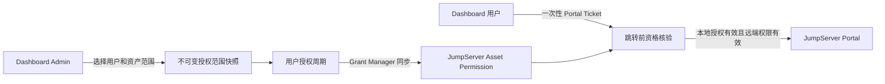

# EKS Dashboard 后端

基于 NestJS 的 Dashboard API 服务，同时包含可部署到 EKS 集群内的 `dashboard-db-gateway-agent` 入口。

## 架构

```text
Browser
  -> Dashboard Frontend
  -> Dashboard Backend (/api, 默认 3000)
  -> Kubernetes Service Proxy
  -> 各环境集群内 Agent / 管理端服务
```

中心后端负责认证、权限、审计、环境路由和受控操作；涉及集群内数据库、Redis 或 Ingress 的操作优先通过目标环境的 Agent / Service Proxy 执行，避免中心服务直接保存或使用业务数据库凭证。

主要模块包括：认证与权限、环境与 siteconf、Deployment、线路、查询中心、资产、站点监控、SSL、KMS、审计、告警和值班。

## 本地开发

推荐从仓库根目录启动完整开发环境：

```bash
./scripts/dev.sh start
```

仅启动后端：

```bash
npm ci
npm run start:dev
```

默认监听 `0.0.0.0:3000`，API 前缀为 `/api`。

## 配置边界

复制 `.env-example` 为 `.env`，填写 Dashboard 自身数据库的启动级连接配置：

```dotenv
DB_HOST=127.0.0.1
DB_PORT=3306
DB_USER=dashboard
DB_PASSWORD=replace-me
DB_DATABASE=replace-me
PORT=3000
```

配置原则：

- `dashboard_site_conf`：管理 Dashboard 运行期配置、业务开关与敏感配置；优先于兼容性环境变量。
- `environments_config`：管理环境元数据、Kubernetes context、目标 AWS Role ARN 等环境级配置。
- AWS：生产环境使用 EC2 Instance Role / IRSA，再按环境 `aws_role_arn` AssumeRole；不要恢复或新增环境 AK/SK、`aws_profile` 作为运行时主路径。
- 集群访问：通过 kubeconfig context 和 Kubernetes RBAC 访问目标集群；中心服务到环境 Agent 使用 Service Proxy 与 `X-Agent-Token`。

`.env`、siteconf 导出、kubeconfig、数据库导出以及所有密钥均不得提交到仓库或前端构建产物。

## JumpServer 授权链路

“服务器访问（JumpServer）”由 Dashboard 管理身份映射、期望授权、有效期、回收和审计，JumpServer 负责执行 Asset Permission、登录认证和实际会话。Dashboard 不保存 JumpServer 用户密码、Cookie、私钥、录像或命令正文。



授权范围快照保存在 `jumpserver_access_bundles`，每次授权周期保存在 `jumpserver_user_bundle_bindings`。当前授权和历史授权不会覆盖彼此：

- “调整有效期”只允许操作仍有效、未进入回收流程的当前授权，并原地更新对应受管 Asset Permission；不会创建重复授权。
- “重新授权”只允许操作已经成功回收且位于授权链末端的历史周期。系统保留原记录并创建新范围快照和新周期，通过 `reauthorized_from_binding_id` 形成 `A -> B -> C` 链。
- 旧周期一旦已有后继，就不能再次重新授权；后端在事务内锁定来源记录并检查后继，避免并发请求形成分叉。
- 资产授权有效期不得超过 JumpServer 用户的 `date_expired`。两项操作均要求 MFA、后端动作权限和审计原因。

相关权限如下：

| 权限键 | 用途 |
| --- | --- |
| `jumpserver:config:manage` | 管理 Provider、身份映射和用户资产授权 |
| `jumpserver:sync:execute` | 执行授权同步、撤销和人工对账 |
| `jumpserver:grant:extend` | 调整当前授权有效期 |
| `jumpserver:grant:reauthorize` | 从授权链最新的历史周期重新授权 |
| `jumpserver:portal:launch` | 核验本人有效范围并发起受控跳转 |
| `jumpserver:audit:read` | 查看跳转、同步和授权事件 |

远端读取使用 Reader 身份，受管 Permission 写入和回收使用 Grant Manager 身份；凭证来自敏感 SiteConf，不能返回前端或进入日志。实现入口为 [`src/jumpserver-access`](src/jumpserver-access)，数据迁移见 [`scripts/sql/2026-10-24_jumpserver_grant_lifecycle.sql`](scripts/sql/2026-10-24_jumpserver_grant_lifecycle.sql)，完整设计和验证边界见 [JumpServer 集成开发计划](../docs/2026-10-18-dashboard-jumpserver-integration-development-plan.md)。

## Agent 入口

同一代码库可构建 Agent 入口：

```bash
npm run build:agent
npm run start:agent:dev
```

Agent 默认监听 `8080`，提供 `/v1/...` 受保护接口和 `/metrics`。生产环境应部署到目标 EKS 集群，并配置独立 ServiceAccount、最小 RBAC、网络访问规则和 Agent Token；不要将 Agent 直接暴露到公网。

## 验证命令

```bash
npm run build        # 构建中心后端
npm run build:agent  # 构建 Agent 入口
npm test             # Jest 单元测试
```

## 生产运行与发布

根目录的 `ecosystem.prod.config.js` 管理两个 PM2 进程：

- `eks-dashboard-backend`：运行 `dist/main.js`
- `eks-dashboard-frontend`：预览前端构建产物

发布脚本与 GitHub Actions 说明见 [部署文档](../docs/github-actions-deployment.md)。部署后应至少验证登录、`/api` 健康访问、目标环境权限、Agent 连通性及关键审计记录。

## 安全要求

- 写操作必须在后端完成授权与审计；高风险数据库写入、解密或基础设施操作应要求 MFA / 明确确认。
- Ingress 创建先 dry-run，再最终确认；错误信息应保留 Kubernetes 原始原因。
- 不记录明文密码、MFA Secret、AK/SK、Agent Token、私钥或解密结果；日志和审计只保存必要的脱敏摘要。
